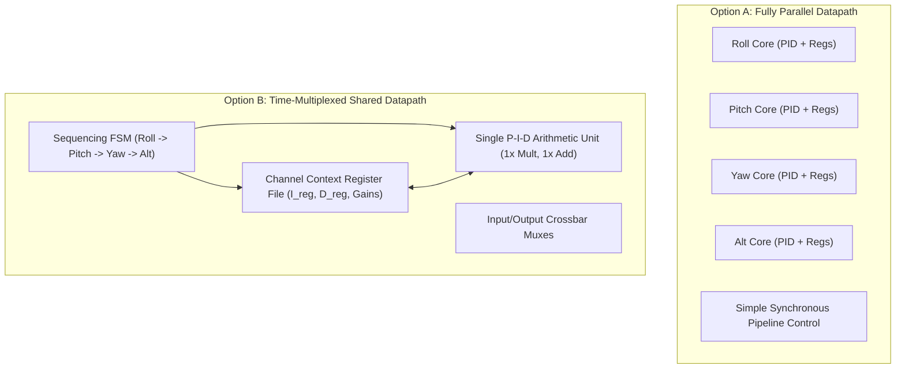
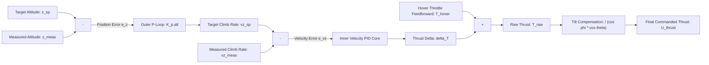
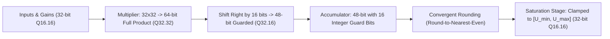
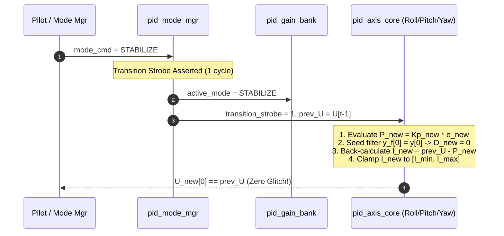

# ARCHITECTURE.md — Hardware PID Flight Controller

**Project:** Mode-Switching Hardware PID Controller for Flight Control (VLSI Hackathon)  
**Root Directory:** `/home/peskybird/Projects/PID`  
**Document Status:** Architectural Specification & Datapath Contract — APPROVED FOR PLANNING  
**Date:** October 2026  

---

## 1. Architectural Principles & System Requirements

The hardware PID controller is designed as a high-reliability, low-latency, hard-real-time digital feedback coprocessor for autonomous and pilot-assisted UAV flight control. The architecture must satisfy seven core requirements:

1. **Multi-Axis Control:** Simultaneous stabilization of three rotational degrees of freedom (**Roll**, **Pitch**, **Yaw**) with integrated vertical **Altitude Hold** ($Z$-axis thrust).
2. **Deterministic Latency:** Fixed, cycle-accurate pipeline latency from sensor sample arrival to registered actuator command output ($L = 1$ clock cycle at 50 MHz = 20.0 ns), eliminating control jitter and phase lag.
3. **Four Operating Modes:**
   - **Acro:** Direct pilot angular rate control (inner loop only).
   - **Stabilize:** Cascaded attitude angle outer loop driving rate inner loop.
   - **Altitude Hold:** Altitude position/velocity loop with tilt-compensated thrust adjustment.
   - **Failsafe:** Autonomous, instant assertion of deterministic safe actuator commands upon fault detection.
4. **Bumpless Mode Transitions:** Active integrator back-calculation and derivative-filter state initialization to prevent control output discontinuities ($\Delta U$) during mode switches.
5. **Robust Anti-Windup:** Conditional integration (clamping) combined with independent integrator state bounds.
6. **Derivative Kick Elimination:** Measurement-based derivative ($-\frac{d y}{d t}$) coupled with a parameterizable first-order low-pass filter (LPF).
7. **Silicon Efficiency & Portability:** Strict IEEE 1800-2012 synthesizable SystemVerilog subset with zero simulator-only constructs, fully portable across Verilator, Yosys, and remote Cadence Genus/Innovus flows.

---

## 2. System Block Diagram & Module Decomposition

```mermaid
flowchart TD
    subgraph SENSORS_RC["Sensor & Command Interfaces"]
        IMU_BUS["IMU Interface: Gyro (p,q,r), Accel (ax,ay,az), sample_valid"]
        ALT_BUS["Altitude Interface: z_meas, vz_meas, alt_valid"]
        RC_BUS["Pilot RC Interface: sp_roll, sp_pitch, sp_yaw, sp_thrust, mode_cmd"]
        CFG_BUS["Configuration Bus: Gain programming & parameter read/write"]
        FS_PIN["External Hardware Failsafe / Arm Input"]
    end

    subgraph PID_TOP["Top-Level Controller: pid_top"]
        WD["Watchdog & Input Sanity Unit<br/><b>pid_watchdog</b>"]
        MODE_MGR["Mode Manager FSM<br/><b>pid_mode_mgr</b>"]
        GAIN_BANK["Multi-Mode Gain Bank Matrix<br/><b>pid_gain_bank</b>"]
        OUTER_LOOP["Outer Attitude & Altitude Loop<br/><b>pid_outer_loop</b>"]

        subgraph INNER_DATAPATH["Inner Rate Datapath: pid_inner_core"]
            ROLL_CORE["Roll Channel Core<br/><b>pid_axis_core</b>"]
            PITCH_CORE["Pitch Channel Core<br/><b>pid_axis_core</b>"]
            YAW_CORE["Yaw Channel Core<br/><b>pid_axis_core</b>"]
        end

        ALT_THRUST["Altitude Thrust Core<br/><b>pid_axis_core</b>"]
        TILT_COMP["Thrust Tilt-Compensation<br/><b>pid_tilt_comp</b>"]
        OUT_STAGE["Output Limiter & Failsafe Mux<br/><b>pid_output_stage</b>"]
    end

    subgraph ACTUATOR_OUTPUTS["Actuator & Telemetry Outputs"]
        PWM_OUT["Actuator Commands (U_roll, U_pitch, U_yaw, U_thrust)"]
        STATUS_OUT["Status & Telemetry (active_mode, fault_code, watchdog_status)"]
    end

    IMU_BUS --> WD
    ALT_BUS --> WD
    WD -->|Sanitized Samples & Valid| MODE_MGR
    WD -->|Sanitized Samples| OUTER_LOOP
    WD -->|Sanitized Gyro (p,q,r)| INNER_DATAPATH
    WD -->|Sanitized (z, vz)| ALT_THRUST
    WD -->|Watchdog Stale Strobe| MODE_MGR

    RC_BUS --> MODE_MGR
    FS_PIN --> MODE_MGR
    CFG_BUS --> GAIN_BANK

    MODE_MGR -->|Active Mode ID & Transition Strobe| GAIN_BANK
    MODE_MGR -->|Bumpless Re-seed Request| INNER_DATAPATH
    MODE_MGR -->|Bumpless Re-seed Request| ALT_THRUST
    MODE_MGR -->|Failsafe Override Strobe| OUT_STAGE

    GAIN_BANK -->|Mode Gains (Kp, Ki, Kd, Bounds)| OUTER_LOOP
    GAIN_BANK -->|Mode Gains (Kp, Ki, Kd, Bounds)| INNER_DATAPATH
    GAIN_BANK -->|Mode Gains (Kp, Ki, Kd, Bounds)| ALT_THRUST

    RC_BUS --> OUTER_LOOP
    OUTER_LOOP -->|p_sp, q_sp, r_sp| INNER_DATAPATH
    OUTER_LOOP -->|vz_sp| ALT_THRUST

    INNER_DATAPATH -->|Torques (Tx, Ty, Tz)| OUT_STAGE
    ALT_THRUST -->|Base Thrust T_base| TILT_COMP
    WD -->|Attitude Angles (phi, theta)| TILT_COMP
    TILT_COMP -->|Tilt-Compensated Thrust| OUT_STAGE

    OUT_STAGE --> PWM_OUT
    MODE_MGR --> STATUS_OUT
    WD --> STATUS_OUT
```

---

## 3. Module Hierarchy & Functional Responsibilities

To avoid over-fragmentation while maintaining strict modularity and unit testability, the design is structured into eight focused modules:

### 3.1. `pid_top` (Top-Level Controller Integration)
- **Role:** Structural top-level wrapper interconnecting sub-modules, synchronizing internal pipeline control signals, registering inputs, and exporting actuator and status ports.
- **Clock/Reset:** Synchronous to single primary clock `clk`, active-low synchronous reset `rst_n`.
- **Latency Contract:** Input-to-output latency is strictly fixed at **$L = 1$ clock cycle (20.0 ns at 50 MHz)**.

### 3.2. `pid_watchdog` (Sensor Freshness & Input Sanity)
- **Role:** Monitors the arrival rate of sensor samples. Detects stale, missing, or frozen IMU and altitude samples.
- **Operation:**
  - Counter increments on every clock cycle and resets to zero upon receiving a valid `sample_valid` pulse.
  - If counter exceeds programmable threshold `cfg_timeout_cycles` (default: 50,000 cycles = 1.0 ms at 50 MHz), asserts `watchdog_stale_fault`.
  - Enforces sample sanitization: checks sensor parity/valid flags and boundary clamping.
  - Generates sticky fault status register `reg_fault_code`.

### 3.3. `pid_mode_mgr` (Mode Management & Transition FSM)
- **Role:** Autonomous state machine orchestrating operating modes and transitions.
- **States:** `MODE_ACRO` (00), `MODE_STABILIZE` (01), `MODE_ALTHOLD` (10), `MODE_FAILSAFE` (11).
- **Transitions:**
  - Governed by pilot commands `mode_cmd[1:0]` unless overridden by faults.
  - Unconditional, single-cycle jump to `MODE_FAILSAFE` if `watchdog_stale_fault`, `sensor_invalid`, or `external_failsafe` is asserted.
  - Recovery from `MODE_FAILSAFE` requires fault clearance AND explicit pilot re-arm toggle.
  - Upon any permitted transition, generates a 1-cycle `transition_strobe` and captures `prev_mode` and `target_mode`.

### 3.4. `pid_gain_bank` (Mode-Indexed Gain Matrix)
- **Role:** Stores and multiplexes parameter sets for each mode.
- **Contents per Channel:** Proportional gain ($K_p$), Integral gain ($K_i$), Derivative gain ($K_d$), Filter coefficient ($\alpha$), Output limits ($U_{min}, U_{max}$), Integrator limits ($I_{min}, I_{max}$).
- **Interface:** Dynamically selected by `active_mode[1:0]`. Reprogrammable via synchronous configuration interface `cfg_*`.

### 3.5. `pid_outer_loop` (Attitude & Altitude Outer Controllers)
- **Role:** Implements the slow outer attitude angle and altitude position loops.
- **Attitude Loop (Roll & Pitch):** Computes angle error:
  $$e_\phi = \phi_{sp} - \phi_{meas}, \quad e_\theta = \theta_{sp} - \theta_{meas}$$
  Outputs desired body rates:
  $$\omega_{sp,roll} = K_{p,att} \cdot e_\phi, \quad \omega_{sp,pitch} = K_{p,att} \cdot e_\theta$$
  In Acro mode, the outer loop is bypassed, routing pilot stick rates directly to the inner loop.
- **Altitude Position Loop:** Computes vertical error:
  $$e_z = z_{sp} - z_{meas} \implies v_{z,sp} = K_{p,alt} \cdot e_z$$
  Routes $v_{z,sp}$ to the altitude rate core.

### 3.6. `pid_axis_core` (Parameterized Single-Channel PID Core)
- **Role:** High-speed inner feedback engine. Reused across Roll, Pitch, Yaw, and Altitude thrust channels.
- **Internal Sub-Blocks:**
  1. **`pid_deriv_filter`:** Measurement-based derivative with first-order IIR LPF.
  2. **`pid_prop_unit`:** Proportional error multiplication with gain scaling.
  3. **`pid_integ_unit`:** Accumulator with conditional integration (anti-windup clamping) and bumpless re-seeding input port.
  4. **`pid_sat_unit`:** 48-bit summation ($P + I + D$), output saturation clamping to $[U_{min}, U_{max}]$, and clamping status flags.

### 3.7. `pid_tilt_comp` (Thrust Tilt Compensation)
- **Role:** Adjusts vertical thrust during multirotor pitch and roll angles to prevent altitude sag during forward/lateral flight:
  $$T_{compensated} = \frac{T_{base}}{\cos(\phi) \cdot \cos(\theta)}$$
- **Implementation:** Realized via low-cost Taylor expansion / fixed-point small-angle approximation:
  $$\frac{1}{\cos\phi \cos\theta} \approx 1 + \frac{1}{2}\phi^2 + \frac{1}{2}\theta^2$$
  Capped at a maximum scaling of $1.5\times$ (approx. $48^\circ$ tilt) to avoid motor saturation.

### 3.8. `pid_output_stage` (Actuator Output Limiter & Failsafe Mux)
- **Role:** Final safety barrier before actuator command delivery.
- **Operation:**
  - Normal operation: Registers and outputs compensated commands $U_{roll}, U_{pitch}, U_{yaw}, U_{thrust}$.
  - Failsafe assertion: Overrides all channels instantly (within 1 clock cycle) with configurable safe-state constants:
    $$U_{roll} = 0, \quad U_{pitch} = 0, \quad U_{yaw} = 0, \quad U_{thrust} = U_{failsafe\_thrust} \text{ (or 0 / Disarm)}$$

---

## 4. Architectural Trade-Off: Parallel PID Cores vs. Shared Datapath

A critical architectural decision is whether to instantiate **three (or four) parallel PID channel cores** or to time-multiplex a **single shared arithmetic datapath** across all axes.



### Detailed Trade-Off Comparison Matrix

| Evaluation Dimension | Option A: Parallel Cores (Selected Baseline) | Option B: Shared Datapath (Alternative) | Design Impact & Rationale |
| :--- | :--- | :--- | :--- |
| **Logic Cell Area (Gates)** | $\sim 18,000 - 24,000$ cells | $\sim 7,500 - 10,500$ cells | Parallel consumes $\approx 2.3\times$ more logic gates. However, on any modern CMOS node ($\le 130$ nm), 24k cells occupies $< 0.12\text{ mm}^2$, an insignificant silicon footprint. |
| **Hardware Multipliers** | 12 to 16 multipliers ($32 \times 32$) | 3 to 4 multipliers ($32 \times 32$) | Parallel replicates arithmetic multipliers; shared reuses them over time. |
| **Throughput & Pipeline Latency** | **$L = 1$ cycle (20 ns)** total for all axes simultaneously | **$L = 4 - 8$ cycles** sequential | Parallel delivers minimum latency (20 ns) and zero inter-axis skew. |
| **Clock Budget Feasibility** | Abundant margin: at 50 MHz and 4 kHz sample rate, sample period is 12,500 cycles. | Abundant margin: 24 cycles is still $< 0.2\%$ of available 12,500 cycle window. | Clock budget is non-critical for both options; flight control sample rates are low relative to ASIC clock frequencies. |
| **Control Logic Complexity** | **Very Low:** Pure feed-forward synchronous pipeline registers with identical delay matching. | **High:** Multi-state sequencing FSM, register-file addressing, context read/modify/write hazards, complex stall logic. | Shared datapath significantly increases state-space complexity and control bugs. |
| **Formal Verification Tractability** | **Trivial:** Each axis core is an isolated mathematical block; SMT proofs converge in seconds. | **Difficult:** SMT solvers must reason across multiple unrolled sequencing cycles and RAM/RF states; proof depth explodes. | Formal verification with SymbiYosys/Z3 is vastly superior on parallel cores. |
| **Fault Isolation** | **High:** Arithmetic fault or overflow in one channel cannot corrupt another channel's state registers. | **Low:** Single datapath defect or memory pointer glitch corrupts all 4 flight axes simultaneously. | Parallel design provides vital safety redundancy and failure isolation for flight control. |

### Architectural Recommendation
**Baseline Decision:** **Option A (Fully Parallel Cores)** is chosen as the primary implementation architecture.
- *Justification:* In flight-control hardware, reliability, verification simplicity, and absolute fault isolation far outweigh marginal silicon area savings. A modular `pid_axis_core` instantiated 4 times guarantees deterministic timing, simple formal properties, and zero multi-cycle context hazards.
- *Provisional Fallback:* The `pid_axis_core` is designed with clean parameterization so that if strict hackathon silicon area limits are later imposed, a shared time-multiplexed wrapper can be dropped in without redesigning the underlying arithmetic blocks.

---

## 5. Altitude Hold: Physical Analysis, Sensor Interface & Assumptions

> [!CAUTION]
> **Fundamental Control Limitation:** An Inertial Measurement Unit (IMU) alone (accelerometers + gyroscopes) **CANNOT** maintain stable altitude hold over time.

### 5.1. Physical Rationale
1. **Double Integration Drift:** Vertical position is the double integral of vertical acceleration ($z(t) = \iint a_z dt^2$). Any residual accelerometer DC bias $\epsilon_a$ (typically $5 - 20\text{ mg}$ in MEMS IMUs) causes position error to grow quadratically:
   $$\Delta z(t) = \frac{1}{2} \epsilon_a t^2$$
   Within 5 seconds, an uncorrected $10\text{ mg}$ bias produces a $> 1.2\text{ meter}$ altitude drift; within 30 seconds, $> 44\text{ meters}$.
2. **Gravity Projection Errors:** During pitch ($\theta$) and roll ($\phi$) maneuvers, the large gravity vector ($1g \approx 9.81\text{ m/s}^2$) rotates into body axes. A tiny $0.5^\circ$ error in attitude angle estimation projects a false vertical acceleration component of $g \cdot (1 - \cos 0.5^\circ) \approx 0.0037\text{ m/s}^2$, generating severe vertical velocity runaway.

### 5.2. Sensor Interface Specification
Altitude Hold requires an external vertical measurement source:
- **Primary Measurement Inputs:**
  - `alt_z_meas[31:0]` (Signed Q16.16, meters relative to takeoff/target datum).
  - `alt_vz_meas[31:0]` (Signed Q16.16, meters/second vertical climb/sink velocity).
  - `alt_valid` (Single-bit strobe indicating valid, fresh measurement).
- **Physical Sensor Sources (External to PID Core):**
  - High-precision Barometer (e.g., BMP280, DPS310) providing absolute pressure altitude.
  - Downward Time-of-Flight / LiDAR / Sonar rangefinder for ground-truth distance ($< 4\text{ m}$).
  - External Sensor Fusion Filter / EKF (typically running on the flight CPU or dedicated estimator core) fusing barometer pressure with $a_z$ accelerometer readings.

### 5.3. Cascaded Altitude Control Topology


### 5.4. Unresolved Requirements & Assumptions
- **Assumption 1:** The external system provides estimated vertical velocity `alt_vz_meas` directly, or the hardware PID core must derive it via backward difference with heavy filtering. (*Provisional: Assume external fused $v_z$ input is provided; fall back to internal filtered difference if invalid*).
- **Assumption 2:** The hover throttle baseline $T_{hover}$ is supplied via configuration register `cfg_hover_thrust` (representing nominal 50% hover throttle).
- **Unresolved Requirement:** What is the fallback behavior if `alt_valid` drops while in Altitude Hold mode? (*Provisional: Controller triggers an immediate graceful degradation to Stabilize mode with manual throttle passthrough, rather than emergency disarm*).

---

## 6. Fixed-Point Datapath Arithmetic & Precision Rules

To achieve high numerical accuracy while preventing arithmetic overflow and limit-cycle oscillation, the entire datapath utilizes **32-bit signed two's complement fixed-point arithmetic in Q16.16 format**.



### 6.1. Numeric Format Definitions
- **Format:** Signed Q16.16 (1 sign bit, 15 integer bits, 16 fractional bits).
- **Dynamic Range:** $[-32,768.0, +32,767.9999847]$.
- **Fractional Resolution:** $\Delta = 2^{-16} \approx 1.5258789 \times 10^{-5}$.
- **Gain Representation:** Q16.16 format for $K_p, K_i, K_d$.
- **Actuator Limits:** Normalized control effort where $1.0 = 65,536$ counts. Full-scale range is typically $[0, +1.0]$ for motor throttle and $[-1.0, +1.0]$ for rotational torques.

### 6.2. Intermediate Widths & Guard Bits
1. **Multiplication:**
   - Operand $A$ (32-bit Q16.16) $\times$ Operand $B$ (32-bit Q16.16) yields a **64-bit product** in Q32.32 format.
   - Truncation/Shift: Right-shifted by 16 fractional bits to produce a **48-bit intermediate value** in Q32.16 format.
2. **Accumulation & Summation:**
   - The parallel summation $U_{raw} = P + I + D$ is evaluated in a **48-bit accumulator**.
   - **Guard Headroom:** The 48-bit accumulator provides 16 additional integer guard bits above the standard 32-bit format. This mathematically guarantees that intermediate accumulation can never overflow or wrap around, even if $P, I,$ and $D$ all peak simultaneously at their maximum bounds.
3. **Rounding:**
   - To eliminate DC truncation bias (which causes steady-state drift in integrators), intermediate results undergo **convergent round-to-nearest-even**:
     $$\text{Round}(X) = \lfloor (X + 2^{F-1} + \text{LSB}(X_{int})) \gg F \rfloor$$
4. **Saturation Logic:**
   - Before outputting to the 32-bit registers, values are passed through explicit saturating clampers:
     $$X_{sat} = \begin{cases} U_{max}, & \text{if } X > U_{max} \\ U_{min}, & \text{if } X < U_{min} \\ X, & \text{otherwise} \end{cases}$$
   - **Overflow Safety Rule:** Wrap-around arithmetic is strictly forbidden in synthesizable RTL.

### 6.3. Derivative Unit: Measurement-Based with Low-Pass Filtering
To prevent "derivative kick" when pilot setpoints change abruptly, derivative action is derived exclusively from sensor measurement feedback $y[n]$ (e.g., gyro angular rate):
$$D(s) = -K_d \cdot \frac{s}{1 + s T_f} \cdot Y(s)$$

In discrete time, this is realized via a first-order IIR low-pass filter:
$$y_f[n] = y_f[n-1] + \alpha \cdot (y[n] - y_f[n-1])$$
$$D[n] = -K_d \cdot \frac{y_f[n] - y_f[n-1]}{T_s}$$
where $\alpha \in [0, 1.0)$ is represented in Q16.16 format.

### 6.4. Integrator Unit & Anti-Windup Protection
Integrator accumulation follows:
$$I[n] = I[n-1] + K_i \cdot e[n] \cdot T_s$$
**Conditional Integration (Anti-Windup Clamping):**
Accumulation into $I[n]$ is conditionally frozen (`integ_freeze = 1`) if:
1. Actuator output is saturated high ($U_{raw} \ge U_{max}$) **AND** error is positive ($e[n] > 0$).
2. Actuator output is saturated low ($U_{raw} \le U_{min}$) **AND** error is negative ($e[n] < 0$).
Additionally, the state register $I[n]$ is clamped independently to $[I_{min}, I_{max}]$.

---

## 7. Bumpless Mode Transitions & State Re-Seeding

When transitioning between operating modes (e.g., Acro $\rightarrow$ Stabilize or Stabilize $\rightarrow$ Acro), the control loop experiences:
1. A discontinuous change in error definition (rate error vs. angle error).
2. A discontinuous swap of active gains ($K_p, K_i, K_d$).

Without compensation, this produces an instantaneous output step ($\Delta U$), causing aggressive motor current spikes and physical aircraft jerks.



### 7.1. Algebraic Back-Calculation Formula
Let the last valid control output before transition be $U_{prev}$. Upon asserting `transition_strobe` into mode $M_{new}$:
1. Compute the new instantaneous proportional term:
   $$P_{new}[0] = K_{p,new} \cdot e_{new}[0]$$
2. Seed the derivative filter state with the current raw measurement:
   $$y_f[0] = y[0] \implies \Delta y_f = 0 \implies D_{new}[0] = 0$$
3. Back-calculate and latch the initial integrator state:
   $$I_{new}[0] = \text{clamp}(U_{prev} - P_{new}[0], I_{min,new}, I_{max,new})$$
4. Consequently, the resulting initial control effort is:
   $$U_{new}[0] = P_{new}[0] + I_{new}[0] + D_{new}[0] = P_{new}[0] + (U_{prev} - P_{new}[0]) + 0 = U_{prev}$$
This guarantees mathematical continuity ($\Delta U = 0$) across the transition boundary.

---

## 8. Clocking, Reset & Latency Contracts

### 8.1. Clock and Reset Architecture
- **Primary Clock (`clk`):** Single synchronous clock domain. Target frequency: **50.0 MHz** ($T_{clk} = 20.0\text{ ns}$).
- **Reset (`rst_n`):** Synchronous active-low system reset. Upon reset assertion, all pipeline stages, integrators, filter states, and fault registers are deterministically cleared to zero within 1 clock cycle.
- **Clock Domain Crossing (CDC):** The controller operates strictly as a single-clock synchronous design. Sensor SPI/I2C receivers and telemetry transmitters are expected to synchronize signals into `clk` prior to presenting `sample_valid`.

### 8.2. Pipeline Timing & Latency Contract ($L = 6$ Cycles)
When a fresh sensor vector arrives with `sample_valid = 1`, the controller processes the sample through a 6-stage feedforward pipeline:

```mermaid
gantt
    title Cycle-by-Cycle Pipeline Latency Contract (6 Cycles)
    dateFormat X
    axisFormat Cycle %X
    section Pipeline Stages
    Stage 0 : Input Registering & Sanitization : 0, 1
    Stage 1 : Outer Loop Error & Mode Gain Latch : 1, 2
    Stage 2 : Multiplier Stage (P, I_delta, D_delta) : 2, 3
    Stage 3 : Accumulation & Derivative IIR Filter : 3, 4
    Stage 4 : 48-bit Summation & Tilt Compensation : 4, 5
    Stage 5 : Output Saturation & Failsafe Mux Register : 5, 6
```

- **Cycle 0 ($T_0$):** `sample_valid` strobe asserted. Sensors, setpoints, and mode commands evaluate combinationally through the gain bank, outer loop, 4 parallel PID axis cores (P, I, D terms and saturation), tilt compensation, and failsafe multiplexer.
- **Cycle 1 ($T_1$):** At `posedge clk`, `pid_output_stage` registers the active actuator commands (`u_roll`, `u_pitch`, `u_yaw`, `u_thrust`), asserts `output_valid`, and updates integrator and filter state registers.

**Guaranteed Latency:** Exactly **1 clock cycle (20.0 ns at 50 MHz)** from `sample_valid` to `output_valid`.

---

## 9. Top-Level Port Interface Specification

```systemverilog
module pid_top #(
    parameter int WIDTH       = 32,
    parameter int FRACT_W     = 16,
    parameter int TIMEOUT_CYC = 50000
) (
    // Clock and Synchronous Active-Low Reset
    input  logic              clk,
    input  logic              rst_n,

    // Sensor Sample Interface (Synchronous Strobe)
    input  logic              sample_valid,
    output logic              sample_ready,
    input  logic signed [31:0] imu_p,          // Roll angular rate (rad/s or deg/s, Q16.16)
    input  logic signed [31:0] imu_q,          // Pitch angular rate
    input  logic signed [31:0] imu_r,          // Yaw angular rate
    input  logic signed [31:0] imu_phi,        // Roll attitude angle
    input  logic signed [31:0] imu_theta,      // Pitch attitude angle
    input  logic signed [31:0] alt_z,          // Vertical altitude (meters, Q16.16)
    input  logic signed [31:0] alt_vz,         // Vertical velocity (m/s, Q16.16)
    input  logic              alt_valid,       // Altitude sensor valid flag

    // Pilot Command & Mode Interface
    input  logic [1:0]        mode_cmd,        // 00=Acro, 01=Stabilize, 10=AltHold, 11=Failsafe
    input  logic              failsafe_ext_n,  // Active-low external emergency kill
    input  logic signed [31:0] rc_sp_roll,     // Setpoint (Rate or Angle depending on mode)
    input  logic signed [31:0] rc_sp_pitch,
    input  logic signed [31:0] rc_sp_yaw,
    input  logic signed [31:0] rc_sp_thrust,

    // Memory-Mapped Parameter / Gain Configuration Interface
    input  logic              cfg_we,
    input  logic [7:0]        cfg_addr,
    input  logic [31:0]       cfg_wdata,
    output logic [31:0]       cfg_rdata,

    // Actuator Command Outputs
    output logic              output_valid,
    output logic signed [31:0] u_roll,         // Actuator roll command (Q16.16)
    output logic signed [31:0] u_pitch,        // Actuator pitch command
    output logic signed [31:0] u_yaw,          // Actuator yaw command
    output logic signed [31:0] u_thrust,       // Actuator thrust command

    // Status and Telemetry
    output logic [1:0]        active_mode,     // Current operational mode
    output logic [3:0]        fault_code,      // Diagnostic fault register
    output logic              watchdog_alarm,  // Watchdog timeout indicator
    output logic              saturated_flag   // Asserted if any output is clamped
);
```
