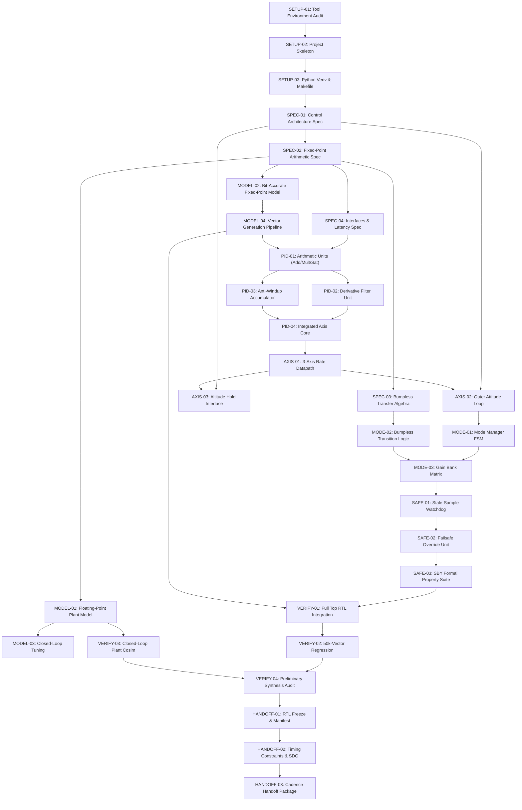
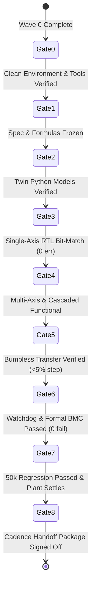

# IMPLEMENTATION_PLAN.md — Hardware PID Flight Controller

**Project:** Mode-Switching Hardware PID Controller for Flight Control (VLSI Hackathon)  
**Root Directory:** `/home/peskybird/Projects/PID`  
**Document Status:** Master Implementation Plan — APPROVED FOR PLANNING (No Implementation Commenced)  
**Author:** Hardware Architecture & Verification Team  
**Date:** October 2026  

---

## 1. Executive Summary & Project Goals

This project develops a high-reliability, deterministic-latency, multi-axis hardware PID controller optimized for flight-control applications (multirotors and fixed-wing UAVs). The controller implements digital feedback control across three primary rotational axes (**Roll**, **Pitch**, **Yaw**) and integrates vertical **Altitude Hold** capability, governed by an autonomous **Mode Management Engine** supporting four distinct operating regimes:
1. **Acro Mode:** High-rate inner angular velocity control loop.
2. **Stabilize Mode:** Dual-loop cascaded attitude (angle) outer loop driving inner rate loop.
3. **Altitude Hold Mode:** Barometric/estimator-coupled vertical position and velocity control coordinated with attitude tilt-compensation.
4. **Failsafe Mode:** Immediate, deterministic safe-state assertion triggered by stale sensor watchdog timeouts, invalid sensor strobes, or hardware faults.

### Key Architectural Differentiators
- **Zero-Glitch Bumpless Transfer:** Automatic integrator back-calculation and derivative-filter state seeding during mode switches to eliminate control-surface twitch and motor current spikes.
- **Anti-Windup Protection:** Clamping-based conditional integration combined with independent accumulator saturation bounds.
- **Measurement-Derived Derivative with Low-Pass Filtering:** Derivative action computed strictly on filtered sensor feedback ($-\frac{d y}{d t}$) to eradicate setpoint derivative kick.
- **Deterministic Pipeline Latency:** Fixed, cycle-accurate latency contract from sensor sample arrival to actuator command output.
- **Dual-Model Golden Verification:** Coupled floating-point plant simulation (for control stability, overshoot, and settling time) and bit-accurate fixed-point reference models (for cycle-by-cycle equivalence).
- **Two-PC Tool Flow Separation:** Local environment dedicated to synthesizable RTL, Verilator simulation, Python co-simulation, and SymbiYosys/Z3 formal proofs; remote Cadence environment reserved for physical synthesis, place-and-route, STA, and sign-off.

---

## 2. Project Scope & Boundary Conditions

### In-Scope (Local Development PC)
- Parameterized, portable synthesizable RTL in SystemVerilog (IEEE 1800-2012 synthesizable subset).
- Bit-accurate Python fixed-point model mirroring every intermediate register, truncation, rounding, and saturation stage.
- Python continuous/discrete plant simulation modeling 6-DOF quadrotor rotational and vertical dynamics.
- Unit, subsystem, and top-level testbenches executed via Verilator (`--binary` self-checking harnesses).
- Formal property proofs using SymbiYosys (`sby`) and Z3 for safety invariants, bounded outputs, and watchdog guarantees.
- Preliminary structural checks and cell-count sanity checks via Yosys (strictly non-sign-off).
- Clean Cadence handoff packaging (source manifest, timing contracts, test vectors, and SDC constraints).

### Out-of-Scope (Deferred to Remote Cadence Workstation)
- PDK-specific standard-cell synthesis and mapping (e.g., Cadence Genus).
- Physical floorplanning, placement, clock tree synthesis (CTS), and routing (Cadence Innovus).
- Sign-off static timing analysis across multi-corner PVT (Cadence Tempus).
- Physical DRC, LVS, and GDSII stream-out (Cadence Pegasus/PVS).
- Silicon-level power estimation with post-route parasitics (Cadence Voltus).

---

## 3. Top-Level System Architecture Overview

```mermaid
flowchart TD
    subgraph SENSORS["Sensor & Telemetry Inputs"]
        IMU["IMU (Gyro p,q,r + Accel ax,ay,az)"]
        BARO["Altitude Sensor / Estimator (z, vz)"]
        RC["Pilot RC Setpoints (Rate / Angle / Alt)"]
        FS_PIN["Hardware Failsafe / Arm Switch"]
    end

    subgraph PID_TOP["Top-Level Controller (pid_top)"]
        WD["Watchdog & Input Sanity Unit<br/>(pid_watchdog)"]
        MODE["Mode Manager & FSM<br/>(pid_mode_mgr)"]
        GAINS["Gain Bank Matrix<br/>(pid_gain_bank)"]
        OUTER["Outer Loop: Attitude & Altitude<br/>(pid_outer_loop)"]
        
        subgraph DATAPATH["Rotational Rate Datapath (3 Channels)"]
            ROLL["Roll PID Core<br/>(pid_axis_core)"]
            PITCH["Pitch PID Core<br/>(pid_axis_core)"]
            YAW["Yaw PID Core<br/>(pid_axis_core)"]
        end

        ALT_CORE["Altitude Rate/Thrust Core<br/>(pid_axis_core)"]
        TILT_COMP["Tilt Compensation Engine<br/>(pid_tilt_comp)"]
        OUT_SAT["Output Limiting & Failsafe Mux<br/>(pid_output_stage)"]
    end

    subgraph ACTUATORS["Actuator Outputs"]
        U_ACT["Motor Mixer / ESC Setpoints (U1..U4)"]
        STATUS["Telemetry & Fault Status"]
    end

    IMU --> WD
    BARO --> WD
    RC --> MODE
    FS_PIN --> MODE
    WD -->|Valid / Stale Flag| MODE

    MODE -->|Active Mode & Transition Strobe| GAINS
    MODE -->|Bumpless Init / Freeze| DATAPATH
    MODE -->|Bumpless Init / Freeze| ALT_CORE
    MODE -->|Failsafe Override Strobe| OUT_SAT

    GAINS -->|Kp, Ki, Kd, Bounds| OUTER
    GAINS -->|Kp, Ki, Kd, Bounds| DATAPATH
    GAINS -->|Kp, Ki, Kd, Bounds| ALT_CORE

    WD -->|Sanitized Measurements| OUTER
    WD -->|Sanitized Measurements| DATAPATH
    WD -->|Sanitized Altitude| ALT_CORE

    OUTER -->|Angle Rate SPs (p_sp, q_sp)| DATAPATH
    OUTER -->|Vert Vel SP (vz_sp)| ALT_CORE

    DATAPATH -->|Torques Tx, Ty, Tz| OUT_SAT
    ALT_CORE -->|Base Thrust T| TILT_COMP
    TILT_COMP -->|Tilt-Compensated Thrust| OUT_SAT

    OUT_SAT --> U_ACT
    MODE --> STATUS
    WD --> STATUS
```

---

## 4. Work Phases & Implementation Waves

The project is structured into nine sequential, gated implementation waves. Work must progress strictly through the acceptance gates; no downstream RTL synthesis or multi-axis integration may occur without verified golden models and arithmetic specifications.


### Wave 0 — Environment & Project Setup
- **Goal:** Establish an isolated, reproducible project skeleton with automated build, lint, and test targets.
- **Key Tasks:** Verify Nix development environment tools; create directory layout; configure Python virtual environment with NumPy/SciPy; construct Makefile with lint and build hooks.
- **Gate:** Verilator, Yosys, SBY, and Python 3.14 execute verified zero-warning dummy tests from the Makefile.

### Wave 1 — Requirements & Arithmetic Specification
- **Goal:** Mathematically formulate the entire control algorithm, signed fixed-point formats, scaling factors, dynamic ranges, and rounding/saturation semantics.
- **Key Tasks:** Specify Q16.16 fixed-point arithmetic rules; document intermediate bitwidths (64-bit products, 48-bit accumulation); formalize derivative LPF difference equation; define anti-windup clamping criteria; specify bumpless transfer back-calculation algebra; define watchdog counter parameters.
- **Gate:** Signed arithmetic specification and bumpless algebraic formulas fully verified by numerical boundary analysis.

### Wave 2 — Python Reference Models
- **Goal:** Develop twin reference models: a 6-DOF floating-point plant simulation model and a bit-accurate fixed-point model.
- **Key Tasks:** Implement continuous/discrete-time quadrotor dynamics; develop floating-point PID controller for gain tuning and stability analysis; implement bit-accurate integer/fixed-point simulator mirroring exact RTL register and saturation behavior; establish vector generator producing test vectors for RTL testbenches.
- **Gate:** Bit-accurate Python model reproduces verified control trajectories, and export vector format is standardized.

### Wave 3 — Single-Axis PID RTL Core
- **Goal:** Implement and thoroughly verify the fundamental, reusable single-channel PID engine (`pid_axis_core`).
- **Key Tasks:** Implement parameterizable proportional unit, IIR filtered derivative unit, anti-windup accumulator unit, and output saturation clamper; build self-checking Verilator testbench (`pid_axis_core_tb`).
- **Gate:** 10,000 randomized and edge-case test vectors match the bit-accurate Python model with **zero bit-level discrepancies**.

### Wave 4 — Multi-Axis & Cascaded Loops
- **Goal:** Expand datapath to 3-axis rotational rate control (Roll, Pitch, Yaw) and integrate the outer attitude angle loops plus the vertical altitude-hold interface.
- **Key Tasks:** Instantiate 3 parallel rate cores; implement outer attitude proportional loop; design tilt-compensation module; specify external altitude estimator/barometer interface; implement inner vertical thrust loop.
- **Gate:** Multi-axis cascaded simulation achieves target angle tracking in co-simulation without axis cross-talk or timing hazards.

### Wave 5 — Modes, Gain Banks & Bumpless Transfer
- **Goal:** Implement the autonomous Mode Management FSM, multi-mode gain banks, and bumpless mode handover logic.
- **Key Tasks:** Construct `pid_mode_mgr` FSM supporting Acro, Stabilize, AltHold, and Failsafe; implement `pid_gain_bank` register banks; implement integrator re-seeding and derivative filter pre-loading on mode transition strobes; verify every valid transition pair.
- **Gate:** Maximum output step transient ($\Delta U$) during mode transitions under active dynamics is bounded to $< 5\%$ of full scale.

### Wave 6 — Watchdog, Failsafe & Formal Verification
- **Goal:** Guarantee safety under sensor degradation or hardware faults; formally prove critical invariants.
- **Key Tasks:** Implement watchdog timer detecting missing or frozen IMU samples; implement instant failsafe multiplexer; write SymbiYosys (`sby`) properties for bounded outputs, failsafe override, reset clearance, and anti-windup clamping; solve with Z3 solver.
- **Gate:** Watchdog trips within exactly $T_{timeout} \pm 1$ cycle; all SBY formal assertions pass bounded model checking (depth 25).

### Wave 7 — Integrated Regression & Plant-Level Evaluation
- **Goal:** Run comprehensive full-chip regression, closed-loop plant simulation, and structural synthesis sanity checks.
- **Key Tasks:** Connect RTL to simulated quadrotor plant via co-simulation; evaluate physical flight metrics (overshoot, settling time, steady-state error); conduct parallel vs. shared datapath area/latency comparison; run non-sign-off structural Yosys synthesis check for cell counts and timing paths.
- **Gate:** Full 50,000-vector regression passes with 0 failures; plant settles within $< 150$ ms with $< 10\%$ overshoot; preliminary cell count documented.

### Wave 8 — Cadence Handoff Package
- **Goal:** Freeze RTL and assemble an unencumbered, portable handoff bundle for physical implementation on the remote workstation.
- **Key Tasks:** Generate source manifest and checksum file; construct technology-independent SDC timing constraint templates; package golden test vectors and reference models; compile comprehensive handoff documentation with unresolved PDK/tool decisions explicitly flagged.
- **Gate:** Handoff package validates completely with relative paths on a clean checkout; zero simulator-specific or proprietary constructs in synthesizable files.

---

## 5. Dependency Graph & Critical Path Analysis



### Critical Path Analysis
The primary critical path runs through:
$$\text{SETUP-03} \rightarrow \text{SPEC-02} \rightarrow \text{MODEL-02} \rightarrow \text{MODEL-04} \rightarrow \text{PID-01} \rightarrow \text{PID-04} \rightarrow \text{AXIS-01} \rightarrow \text{MODE-01} \rightarrow \text{MODE-02} \rightarrow \text{SAFE-02} \rightarrow \text{VERIFY-01} \rightarrow \text{VERIFY-02} \rightarrow \text{HANDOFF-01}$$
Any delay in formalizing the fixed-point arithmetic rules (SPEC-02) or the bit-accurate model (MODEL-02) directly impacts RTL coding. Work on the plant simulation (MODEL-01) and outer altitude spec (AXIS-03) can proceed in parallel once SPEC-01 is established.

---

## 6. Risk Management & Technical Mitigation Matrix

| Risk ID | Risk Description | Severity | Probability | Technical Mitigation Strategy |
| :--- | :--- | :---: | :---: | :--- |
| **RSK-01** | Fixed-point quantization noise or limit cycles causing steady-state attitude jitter | High | Med | Use Q16.16 (32-bit total, 16 fractional bits giving $1.53 \times 10^{-5}$ rad resolution); verify limit cycles in 60-second continuous simulation; implement round-to-nearest-even on truncation. |
| **RSK-02** | Output transient step during mode transition causing actuator glitch | Critical | High | Implement exact integrator back-calculation ($I_{new} = U_{prev} - P_{new}$); seed derivative filter state with initial measurement ($y_{f}[0] = y[0]$); enforce bumpless transition gate ($< 5\%$ step). |
| **RSK-03** | Watchdog false triggers during legitimate sensor jitter or flight computer delays | High | Med | Parameterize watchdog timeout window ($T_{timeout}$ cycles); implement multi-stage deglitching counter requiring $K$ consecutive valid samples before clearing fault. |
| **RSK-04** | Altitude control instability due to IMU vertical drift | Critical | High | Explicitly require external vertical sensor/estimator input ($z, v_z$); do not integrate raw accelerometer $a_z$ open-loop; treat altitude controller as an external setpoint interface with safety fallback. |
| **RSK-05** | Local RTL contains non-synthesizable SystemVerilog constructs rejected by Cadence Genus | Critical | Low | Restrict RTL to strict synthesizable IEEE 1800-2012 subset; enforce Verilator `-Wall` lint checks; run structural Yosys elaboration checks; prohibit initial blocks, fork-join, and non-constant delays in RTL. |
| **RSK-06** | Clock/latency mismatch between outer attitude loop and inner rate loop | Med | Med | Architect both loops to execute in a single synchronous pipeline or strictly synchronize outer-loop updates using sample-enable strobes with zero clock-domain crossings. |
| **RSK-07** | Integrator windup during prolonged actuator saturation | High | Med | Implement combined conditional integration (freeze accumulation when saturated and error has matching sign) and hard clamping bounds on accumulator state. |

---

## 7. Acceptance Gates & Quality Milestones

Advancement across milestones requires passing explicit, objective quality gates:



- **Gate 0 $\rightarrow$ 1 (Environment):** `make lint` and `python3 -c "import numpy, scipy"` succeed without error.
- **Gate 1 $\rightarrow$ 2 (Specification):** All fixed-point bitwidths, saturation thresholds, and bumpless transfer algebraic derivations documented in `ARCHITECTURE.md` and signed off.
- **Gate 2 $\rightarrow$ 3 (Reference Models):** Python bit-accurate model passes internal self-tests; plant model demonstrates stable flight in floating-point simulation.
- **Gate 3 $\rightarrow$ 4 (Unit RTL):** Verilator unit test suite executes 10,000 vectors against `pid_axis_core` with zero bit errors.
- **Gate 4 $\rightarrow$ 5 (Multi-Axis RTL):** 3-axis rate datapath and outer attitude loops demonstrate correct coordinate transformation and cascaded command tracking.
- **Gate 5 $\rightarrow$ 6 (Mode Management):** All 12 permitted mode-transition pairs tested; output continuity verified.
- **Gate 6 $\rightarrow$ 7 (Safety & Formal):** SBY formal BMC proves output bounds and failsafe override; watchdog detects synthetic sample loss within exact cycle bound.
- **Gate 7 $\rightarrow$ 8 (Full Verification):** Complete 50k-vector pseudo-random regression suite passes 100%; closed-loop plant simulation meets overshoot ($<10\%$) and settling time ($<150$ ms) specs.
- **Gate 8 $\rightarrow$ Complete (Handoff):** Package checksum verified, clean git tree, manifest complete, portable paths validated.

---

## 8. Summary of Workflow Conventions

1. **Portable Relative Paths:** All scripts, includes, and testbenches must use project-root-relative paths. No hardcoded `/home/peskybird/...` references in deliverables.
2. **Read-Only External Projects:** The reference environment in `/home/peskybird/Projects/Cordic-Accelerator` is strictly read-only.
3. **No Premature Implementation:** RTL and models will only be coded following explicit user instructions after this planning baseline is approved.
4. **Document Traceability:** Every task, bug, and design decision must reference a stable identifier from `TASK_STATUS.md` and `DECISIONS.md`.
