# PROJECT_SETUP.md — Environment, Toolchain & Directory Structure

**Project:** Mode-Switching Hardware PID Controller for Flight Control (VLSI Hackathon)  
**Root Directory:** `/home/peskybird/Projects/PID`  
**Document Status:** Development Environment & Setup Specification — APPROVED FOR PLANNING  
**Date:** October 2026  

---

## 1. Verified Tool Environment Audit

The local workstation runs an x86_64 Linux environment managed via Nix. An audit of the development environment (referencing the system Nix packages available via the local workspace) confirmed the exact versions and tool availability listed below:

| Tool | Verified Version | Local Binary Location / Method | Verified Role in PID Project |
| :--- | :--- | :--- | :--- |
| **Verilator** | `5.052 (rev v5.052)` | Nix dev shell (`verilator`) | Primary RTL linting and fast C++/binary simulation engine (`--binary`). |
| **Yosys** | `0.69+post` | Nix dev shell (`yosys`) | Preliminary structural checks, cell-count estimation, and SymbiYosys frontend. |
| **GTKWave** | `v3.3.128` | Nix dev shell (`gtkwave`) | Interactive waveform visualization for `.vcd` and `.fst` trace inspection. |
| **Z3** | `4.16.0 (64-bit)` | Nix dev shell (`z3`) | SMT solver backend powering SymbiYosys formal property proofs. |
| **SymbiYosys (SBY)** | Upstream SBY | Nix dev shell (`sby`) | Bounded Model Checking (BMC) for formal safety properties. |
| **Python** | `3.14.7` | Nix dev shell (`python3`) | Execution environment for golden models, plant simulation, and test generation. |
| **virtualenv** | `21.6.1` | Nix dev shell (`python3 -m virtualenv`) | Python virtual environment manager. |
| **GNU Make** | `4.4.1` | `/run/current-system/sw/bin/make` | Build automation orchestration. |
| **GCC** | `15.3.0` | `/run/current-system/sw/bin/gcc` | C++ compilation for Verilator testbenches. |
| **Git** | `2.55.0` | `/home/peskybird/.nix-profile/bin/git` | Version control and handoff tracking. |

> [!NOTE]
> All tool versions above were verified on 2026-10-10 by executing actual command invocations within the local development environment.

---

## 2. Local vs. Remote Tool Responsibilities

To preserve clean handoff boundaries, the project strictly partitions tool responsibilities between the local development PC and the remote Cadence physical implementation workstation:

```mermaid
flowchart LR
    subgraph LOCAL["Local Development Workstation (This PC)"]
        direction TB
        L1["Verilator: Lint, Unit Tests & Co-Simulation"]
        L2["Python: Plant Dynamics & Bit-Accurate Golden Model"]
        L3["SymbiYosys + Z3: Formal Safety Invariants"]
        L4["GTKWave: Waveform Debugging"]
        L5["Yosys: Preliminary Structural/Cell Sanity Checks (Non-Signoff)"]
    end

    subgraph REMOTE["Remote Cadence Workstation (Physical Flow)"]
        direction TB
        R1["Cadence Genus: Production Logic Synthesis & Mapping"]
        R2["Cadence Innovus: Floorplan, Placement, CTS & Detailed Routing"]
        R3["Cadence Tempus: Multi-Corner Static Timing Sign-off (STA)"]
        R4["Cadence Voltus: Post-Route Power Integrity & IR-Drop"]
        R5["Cadence Pegasus / PVS: Physical DRC, LVS & Stream-out (GDSII)"]
    end

    LOCAL ==>|Portable Handoff Package: RTL, SDC, Manifest, Vectors| REMOTE
```



### Strict Boundary Rules
1. **No Local Sign-off Claims:** Local Yosys synthesis results are preliminary structural diagnostics only. Gate counts and timing estimations produced locally will **never** be cited as sign-off metrics.
2. **Cadence Tool Authority:** Cadence Genus and Tempus results running against the target PDK and standard-cell library on the remote PC are the sole authority for silicon timing, area, and power metrics.
3. **No Target PDK Assumptions:** Local scripts will not assume a specific proprietary PDK (e.g., TSMC, GF, or Intel) until the remote setup is confirmed. Local preliminary checks will use open standard cell libraries (e.g., Sky130) or generic GTECH primitives solely for cell-count sanity.

---

## 3. Proposed Project Directory Hierarchy

The project repository `/home/peskybird/Projects/PID` is organized with clean separation between source code, test infrastructure, documentation, and transient build artifacts:

```text
/home/peskybird/Projects/PID/
├── IMPLEMENTATION_PLAN.md      # Master project plan, milestones, and gates
├── ARCHITECTURE.md            # Hardware architecture, datapath, and interfaces
├── VERIFICATION_PLAN.md       # Verification layers, test matrix, and formal specs
├── PROJECT_SETUP.md           # Tool environment audit and setup guide
├── TASK_STATUS.md             # Stable task tracker across Waves 0–8
├── DECISIONS.md               # Confirmed, provisional, and unresolved decisions
├── Makefile                   # Master build, lint, simulation, and regression orchestration
├── flake.nix                  # Dedicated local Nix environment specification
├── .gitignore                 # Exclusion rules for build artifacts and virtualenvs
├── rtl/                       # Synthesizable SystemVerilog source code
│   ├── pkg/
│   │   └── pid_pkg.sv         # Constants, mode encodings, fixed-point parameters
│   ├── core/
│   │   ├── pid_mult.sv        # Signed 32x32 -> 64-bit multiplier stage
│   │   ├── pid_deriv_filter.sv# Measurement-based derivative with IIR LPF
│   │   ├── pid_integ_unit.sv  # Anti-windup accumulator with bumpless re-seed
│   │   ├── pid_sat_unit.sv    # 48-bit summation and saturation clamper
│   │   └── pid_axis_core.sv   # Integrated single-channel PID feedback core
│   ├── modes/
│   │   ├── pid_mode_mgr.sv    # Operating mode FSM and transition controller
│   │   ├── pid_gain_bank.sv   # Multi-mode parameter register bank
│   │   └── pid_outer_loop.sv  # Outer attitude and altitude position loops
│   ├── safety/
│   │   ├── pid_watchdog.sv    # Sensor sample freshness counter & fault strobe
│   │   ├── pid_tilt_comp.sv   # Thrust tilt compensation arithmetic
│   │   └── pid_output_stage.sv# Actuator limiter and failsafe override multiplexer
│   └── pid_top.sv             # Top-level multi-axis controller integration
├── tb/                        # Testbench infrastructure
│   ├── unit/                  # Module-level self-checking testbenches
│   │   ├── pid_axis_core_tb.sv
│   │   ├── pid_deriv_filter_tb.sv
│   │   ├── pid_integ_unit_tb.sv
│   │   └── pid_watchdog_tb.sv
│   ├── top/                   # Integrated chip-level testbenches
│   │   └── pid_top_tb.sv      # Full-chip multi-axis co-simulation testbench
│   └── formal/                # SymbiYosys formal verification harnesses
│       ├── pid_formal.sby     # SBY task definition file
│       └── pid_formal_tb.sv   # Procedural assertion harness
├── models/                    # Python reference models
│   ├── flight_plant_sim.py    # 6-DOF quadrotor rigid-body flight simulator
│   ├── pid_golden_model.py    # Bit-accurate fixed-point reference model
│   ├── generate_vectors.py    # Stimulus generator producing co-simulation vectors
│   └── evaluate_metrics.py    # Control-performance metric calculator
├── vectors/                   # Test vectors and expected golden outputs
│   ├── directed/              # Boundary, extreme value, and transition vectors
│   └── random/                # 50,000 pseudo-random regression vector sets
├── scripts/                   # Auxiliary automation and preliminary synthesis
│   ├── run_regression.sh      # Automated multi-seed regression runner
│   └── prelim_synth.tcl       # Yosys preliminary structural synthesis script
├── constraints/               # Timing constraint templates
│   └── pid_timing.sdc         # Clocks, input/output delays, false paths
└── handoff/                   # Cadence package export directory
    ├── MANIFEST.md            # Checksums, git commit hashes, and file inventory
    └── CADENCE_IMPORT_GUIDE.md# Step-by-step import instructions for Genus/Innovus
```

---

## 4. Reproducible Environment Setup

### 4.1. Nix Environment Activation
The local environment can be activated reproducibly using Nix:
```bash
# Option A: Activate directly using the local flake (to be created in Wave 0)
cd /home/peskybird/Projects/PID
nix develop

# Option B: Activate referencing the verified shared development environment
nix develop /home/peskybird/Projects/Cordic-Accelerator
```

### 4.2. Python Virtual Environment Configuration
To prevent package contamination and ensure reproducible versions of scientific computing libraries, Python dependencies are housed in a dedicated local virtualenv:
```bash
# Step 1: Create local virtual environment inside the Nix shell
python3 -m virtualenv .venv

# Step 2: Activate virtual environment
source .venv/bin/activate

# Step 3: Install scientific computing dependencies
pip install --upgrade pip
pip install numpy scipy matplotlib
```

### 4.3. Master Makefile Conventions
The `Makefile` serves as the single entry point for all local verification and build workflows. Planned standard targets:

| Make Target | Description | Tool Invocations |
| :--- | :--- | :--- |
| `make lint` | Run strict synthesizability and coding lint on all RTL files. | `verilator --lint-only -Wall ...` |
| `make test-unit` | Compile and run all module-level self-checking unit tests. | `verilator --binary ... && ./output/Vunit_*` |
| `make test-formal` | Execute Bounded Model Checking formal property suite. | `sby -f tb/formal/pid_formal.sby` |
| `make sim-plant` | Run 6-DOF quadrotor closed-loop flight dynamics simulation. | `python3 models/flight_plant_sim.py` |
| `make gen-vectors` | Generate 50,000 golden test vectors from bit-accurate model. | `python3 models/generate_vectors.py` |
| `make regression` | Execute full RTL co-simulation against 50,000 vectors. | `verilator --binary pid_top_tb && ./output/Vpid_top_tb` |
| `make prelim-synth`| Run preliminary structural synthesis and cell count check. | `yosys -s scripts/prelim_synth.tcl` |
| `make handoff` | Package RTL, manifest, and test vectors for Cadence PC. | `bash scripts/package_handoff.sh` |
| `make clean` | Remove all generated binaries, waveforms, and logs. | `rm -rf output/ obj_dir/ *.vcd *.log` |

---

## 5. Artifact & Output Directory Management

To prevent clutter and accidental git commits of large binary files:
- All build artifacts (Verilator C++ outputs, compiled binaries, simulation logs) are directed into `output/` and `obj_dir/`.
- Waveform dump files (`.vcd` and `.fst`) are stored exclusively in `output/waves/`.
- Formal verification engine directories (`cordic_formal_*` / `pid_formal_*`) are isolated and cleaned via `make clean`.
- `.gitignore` will explicitly exclude:
  ```gitignore
  output/
  obj_dir/
  .venv/
  *.vcd
  *.fst
  *.log
  pid_formal_*/
  __pycache__/
  ```

---

## 6. Portability & Coding Standards

To ensure the RTL smoothly imports into Cadence Genus and Innovus on the remote workstation without modification:
1. **Strict IEEE 1800-2012 Synthesizable Subset:**
   - Prohibit non-synthesizable constructs: `initial` blocks in synthesizable modules, `#` delays, `fork/join`, non-constant dynamic memory allocation, and real data types.
   - Use `always_ff @(posedge clk)` for sequential logic with synchronous reset.
   - Use `always_comb` for combinational logic to prevent accidental latch inference.
2. **Relative Paths Only:**
   - No absolute paths (`/home/peskybird/...`) in RTL, include files, or script references.
   - All Makefile references use `$(abspath $(CURDIR)/...)` or relative directories.
3. **Explicit Port Declarations:**
   - All ports must have explicit direction (`input` / `output`), signedness (`logic signed`), and vector widths. No implicit 1-bit nets.
4. **Parameterization:**
   - Word length (`WIDTH = 32`), fractional width (`FRACT_W = 16`), and watchdog timeout limits are defined as overridable top-level parameters with defaults in `pid_pkg.sv`.
