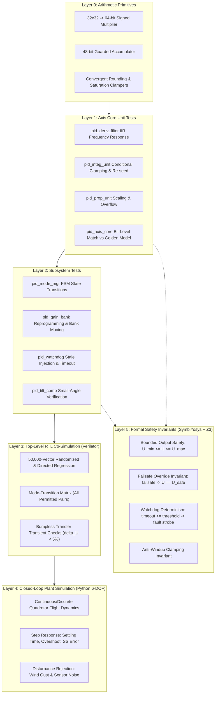

# VERIFICATION_PLAN.md — Hardware PID Flight Controller

**Project:** Mode-Switching Hardware PID Controller for Flight Control (VLSI Hackathon)  
**Root Directory:** `/home/peskybird/Projects/PID`  
**Document Status:** Comprehensive Verification Plan — APPROVED FOR PLANNING  
**Date:** October 2026  

---

## 1. Verification Strategy & Architectural Hierarchy

The verification framework adopts a multi-tier, multi-paradigm strategy designed to ensure both **mathematical bit-level correctness** and **aerodynamic closed-loop stability**. 



### Twin-Model Reference Architecture
1. **Model A (Floating-Point Plant Model - `models/flight_plant_sim.py`):**
   - Implements continuous 6-DOF rigid-body aircraft equations of motion.
   - Evaluates aerodynamic control authority, phase margins, overshoot, and settling time.
   - Tunes nominal PID gains ($K_p, K_i, K_d$) and filter cutoffs ($\alpha$).
2. **Model B (Bit-Accurate Fixed-Point Golden Model - `models/pid_golden_model.py`):**
   - Mirrors RTL architecture with exact two's complement integer arithmetic, 64-bit product truncation, 48-bit accumulator states, convergent rounding, and saturation clipping.
   - Acts as the cycle-accurate golden oracle for Verilator co-simulation testbenches.

---

## 2. Test Layers & Verification Scope

### Layer 0: Arithmetic Primitives
- **Objective:** Verify underlying signed fixed-point arithmetic, rounding, and saturation blocks in isolation.
- **Coverage:**
  - Full boundary testing of signed multipliers: $(-2^{31}) \times (-2^{31})$, $(-2^{31}) \times (+2^{31}-1)$, $0 \times X$.
  - 48-bit accumulator headroom: verify that 16 guard bits prevent overflow when summing maximum positive values.
  - Rounding logic: verify exact round-to-nearest-even tie-breaking ($0.5 \rightarrow$ even integer, $-0.5 \rightarrow$ even integer).
  - Saturation clampers: verify asymmetrical and symmetrical clipping to $[U_{min}, U_{max}]$.

### Layer 1: Core PID Channel Unit Tests (`pid_axis_core`)
- **Objective:** Validate the single-axis feedback channel against the Python bit-accurate model.
- **Coverage:**
  - **Proportional Action:** Verify linear response across full input span; verify saturation at extreme errors.
  - **Derivative Action:** Verify derivative response to step inputs ($d y / dt$ kicks); verify frequency attenuation through first-order IIR LPF; verify zero derivative output when setpoint steps occur with constant measurement.
  - **Integral Action:** Verify ramp integration rate ($K_i \cdot e \cdot T_s$); verify conditional clamping anti-windup (accumulator freezes when output is saturated and error has same sign).
  - **Integrator Re-seeding:** Verify that asserting `reseed_valid` instantaneously overwrites the accumulator with `reseed_val` without one-cycle delay or overshoot.

### Layer 2: Subsystem Tests
- **Objective:** Validate mode management, gain banking, watchdog timing, and tilt compensation.
- **Coverage:**
  - `pid_mode_mgr`: FSM state transitions, illegal transition rejections, emergency jump to Failsafe on fault strobe.
  - `pid_gain_bank`: Write/read verification via configuration bus; zero latency penalty during gain bank switching.
  - `pid_watchdog`: Clock cycle counter accuracy; trip point verification at exactly `TIMEOUT_CYCLES` clock cycles.
  - `pid_tilt_comp`: Quadratic Taylor approximation error verification against $\frac{1}{\cos\phi \cos\theta}$ over $[-45^\circ, +45^\circ]$.

### Layer 3: Top-Level Integrated RTL Co-Simulation (`pid_top`)
- **Objective:** Full-chip co-simulation with synchronized stimulus vectors generated from Python.
- **Coverage:**
  - Simultaneous 3-axis rate control and altitude control execution.
  - Complete mode-switching matrix (all 12 permitted mode-to-mode transitions).
  - Dynamic transition bumpless transfer: monitor transient step $\Delta U = |U[t] - U[t-1]|$ during active control maneuvers.
  - Telemetry and status register consistency check.

### Layer 4: Closed-Loop Plant Simulation
- **Objective:** Measure physical control performance using the simulated quadrotor flight dynamics.
- **Coverage:**
  - Attitude angle tracking: $\pm 30^\circ$ step commands on Roll and Pitch.
  - Yaw rate hold: $\pm 100^\circ/\text{s}$ step commands.
  - Altitude hold: $\pm 5\text{ m}$ step altitude changes.
  - Wind gust disturbance rejection: inject $15\text{ m/s}$ lateral wind gust pulses and measure recovery time.
  - Sensor noise robustness: inject band-limited white noise on gyro ($0.05^\circ/\text{s}/\sqrt{\text{Hz}}$) and accelerometer ($100\ \mu g/\sqrt{\text{Hz}}$).

### Layer 5: Formal Property Verification (SymbiYosys + Z3)
- **Objective:** Formally prove critical safety and bounded-behavior invariants across all possible input sequences using Bounded Model Checking (BMC).
- **Toolchain:** SymbiYosys (`sby`) with Z3 SMT solver.
- **Methodology:** Procedural assertions ($past-based) embedded in formal harness, compatible with Yosys.

---

## 3. Comprehensive Operational Test Matrix

| Test ID | Test Category | Mode Context | Stimulus & Fault Conditions | Expected Observable Behavior | Pass/Fail Gate Criteria |
| :--- | :--- | :--- | :--- | :--- | :--- |
| **TM-01** | Reset & Startup | Any | Assert `rst_n = 0` for 10 cycles during active flight | All internal registers, integrators, and outputs clear to 0 within 1 cycle; mode boots to `MODE_ACRO` upon release. | $U = 0$, $I = 0$, `active_mode = 00` at cycle 1 post-reset. |
| **TM-02** | Acro Mode Step | Acro | Step in rate setpoint $p_{sp} = +200^\circ/\text{s}$, constant gyro feedback | Roll torque $U_{roll}$ steps up proportionally, then ramps with integral action until settling. | Bit-for-bit exact match vs Python bit-accurate model. |
| **TM-03** | Stabilize Cascaded | Stabilize | Step in angle setpoint $\phi_{sp} = +20^\circ$, zero initial angle | Outer loop generates rate setpoint; inner loop commands torque; aircraft angle tracks setpoint. | Angle tracking error $< 0.1^\circ$ at steady state; 0 bit mismatch vs model. |
| **TM-04** | AltHold Nominal | AltHold | Step in altitude setpoint $z_{sp} = +2.0\text{ m}$ with valid barometer/estimator data | Vertical velocity setpoint generated; thrust command increases, settles to hover thrust. | Altitude steady-state error $< 0.05\text{ m}$; thrust command bounded. |
| **TM-05** | AltHold Invalid | AltHold | Deassert `alt_valid` during active Altitude Hold | Controller detects sensor loss; raises status alarm; transitions gracefully to Stabilize mode. | No abrupt thrust drop; mode switches to Stabilize within 1 sample cycle. |
| **TM-06** | Acro $\rightarrow$ Stab | Transition | Switch mode while aircraft is at non-zero rate and non-zero torque ($U = 0.45$) | Bumpless transfer logic re-seeds integrator: $I_{new} = U_{prev} - P_{new}$; seeds derivative filter. | Output step $|\Delta U| \le 0.05 \cdot U_{max}$ (5% of full scale) across transition boundary. |
| **TM-07** | Stab $\rightarrow$ Acro | Transition | Switch mode while aircraft is at $15^\circ$ bank angle | Rate loop initialized smoothly with back-calculated integrator. | Output step $|\Delta U| \le 0.05 \cdot U_{max}$. |
| **TM-08** | Stab $\rightarrow$ AltHold | Transition | Engage Altitude Hold while maneuvering | Altitude thrust begins at current hover thrust; Roll/Pitch attitude loops continue uninterrupted. | Zero glitch on Roll/Pitch torques; vertical thrust smooth handover. |
| **TM-09** | Anti-Windup Pos | Any | Massive sustained error forcing $U_{raw} > U_{max}$ for 2,000 cycles | Integrator accumulation freezes immediately; $I[n]$ does not wind up; rapid desaturation upon error reversal. | Desaturation recovery occurs within 1 sample cycle of error sign inversion. |
| **TM-10** | Anti-Windup Neg | Any | Massive sustained negative error forcing $U_{raw} < U_{min}$ | Integrator accumulation freezes; recovers instantly when error goes positive. | Zero delay in leaving negative saturation boundary. |
| **TM-11** | Deriv Kick Check | Any | Instantaneous step in setpoint $p_{sp}$ while gyro $p_{meas}$ is constant | Proportional term jumps; derivative term $D[n]$ remains strictly zero. | Peak derivative kick magnitude is exactly 0. |
| **TM-12** | Deriv Noise LPF | Any | High-frequency sinusoidal sensor noise injected into $p_{meas}$ ($f = 500\text{ Hz}$) | First-order IIR LPF attenuates noise; derivative output remains smooth and bounded. | High-frequency noise attenuated by $> 18\text{ dB}$ per octave past cutoff. |
| **TM-13** | Watchdog Stale | Any | Cease asserting `sample_valid` for $> \text{TIMEOUT\_CYCLES}$ clock cycles | Watchdog counter trips; asserts `watchdog_alarm`; forces controller to `MODE_FAILSAFE`. | Alarm asserts at exactly $\text{TIMEOUT\_CYCLES} \pm 1$ cycle; $U$ forces to safe output. |
| **TM-14** | Watchdog Recover | Failsafe | Resume valid `sample_valid` strobes without pilot re-arm | Controller remains locked in Failsafe (sticky fault); does NOT auto-recover unsafely. | Controller stays in Failsafe until explicit re-arm strobe received. |
| **TM-15** | Ext Failsafe Kill | Any | Assert active-low `failsafe_ext_n = 0` | Immediate emergency override of all actuator channels within 1 clock cycle. | Actuator commands force to $U_{safe}$ at cycle $T+1$; `active_mode = 11`. |
| **TM-16** | Boundary Math | Any | Present maximum positive inputs ($+2^{31}-1$) and maximum negative inputs ($-2^{31}$) | No numeric wrapping; intermediate 48-bit accumulator guards against overflow; saturates cleanly. | Outputs saturate to $[U_{min}, U_{max}]$; sticky `saturated_flag` asserts. |
| **TM-17** | 50k Regression | All | 50,000 pseudo-randomized cycles with randomized mode switches and noisy inputs | Cycle-by-cycle comparison of all internal pipeline registers against Python golden model. | **100% bit-exact equivalence (0 mismatches across 50,000 vectors).** |

---

## 4. Formal Verification Specification (SymbiYosys / SVA)

Formal properties are defined procedurally to ensure native compatibility with SymbiYosys and the Z3 SMT solver.

### Property P1: Bounded Output Invariant
- **Claim:** Under all operational conditions, non-reset cycles, and arbitrary sensor inputs, the actuator commands can never exceed the configured saturation limits.
- **Formulation:**
  ```systemverilog
  always @(posedge clk) begin
      if (rst_n && output_valid) begin
          assert (u_roll  >= cfg_u_min && u_roll  <= cfg_u_max);
          assert (u_pitch >= cfg_u_min && u_pitch <= cfg_u_max);
          assert (u_yaw   >= cfg_u_min && u_yaw   <= cfg_u_max);
          assert (u_thrust>= cfg_thrust_min && u_thrust <= cfg_thrust_max);
      end
  end
  ```

### Property P2: Failsafe Override Guarantee
- **Claim:** When `active_mode == MODE_FAILSAFE`, the output commands are strictly clamped to the pre-programmed failsafe constants, regardless of sensor data.
- **Formulation:**
  ```systemverilog
  always @(posedge clk) begin
      if (rst_n && (active_mode == 2'b11)) begin
          assert (u_roll   == 32'sd0);
          assert (u_pitch  == 32'sd0);
          assert (u_yaw    == 32'sd0);
          assert (u_thrust == cfg_failsafe_thrust);
      end
  end
  ```

### Property P3: Watchdog Timeout Determinism
- **Claim:** If `sample_valid` remains deasserted for more than `cfg_timeout_cycles`, `watchdog_alarm` must assert within 1 clock cycle.
- **Formulation:**
  ```systemverilog
  always @(posedge clk) begin
      if (rst_n) begin
          if (watchdog_counter >= cfg_timeout_cycles)
              assert (watchdog_alarm == 1'b1);
          else if (watchdog_counter == 0)
              assert (watchdog_alarm == 1'b0);
      end
  end
  ```

### Property P4: Reset Determinism
- **Claim:** Any cycle where `rst_n == 0` forces all internal pipeline registers, integrators, and valid strobes to zero on the following clock edge.
- **Formulation:**
  ```systemverilog
  always @(posedge clk) begin
      if (!rst_n) begin
          assert (output_valid == 1'b0);
          assert (active_mode  == 2'b00); // Boots to Acro
          assert (reg_integ_state == 32'sd0);
      end
  end
  ```

### Property P5: Anti-Windup Clamping Invariant
- **Claim:** When the raw output is saturated at $U_{max}$ and the error is positive, the integrator accumulator register cannot increase on the next update.
- **Formulation:**
  ```systemverilog
  always @(posedge clk) begin
      if (rst_n && sample_valid) begin
          if (u_raw >= cfg_u_max && error > 0)
              assert (reg_integ_state <= $past(reg_integ_state));
          if (u_raw <= cfg_u_min && error < 0)
              assert (reg_integ_state >= $past(reg_integ_state));
      end
  end
  ```

---

## 5. Measurable Pass/Fail Acceptance Criteria

To ensure technical rigor, verification status is assessed strictly against quantitative numerical gates:

| Verification Category | Evaluation Metric | Quantitative Acceptance Threshold | Failure Condition |
| :--- | :--- | :--- | :--- |
| **Bit-Accurate Equivalence** | Discrepancy between RTL and Fixed-Point Golden Model | **Exactly 0 bit errors** across 50,000 co-simulation vectors | Any bit mismatch on any channel output register. |
| **Attitude Step Response** | 10% to 90% Rise Time ($t_r$) on $20^\circ$ pitch step | **$t_r \le 60\text{ ms}$** | $t_r > 80\text{ ms}$ |
| **Attitude Overshoot** | Peak percentage overshoot on $20^\circ$ step | **$M_p \le 10.0\%$** (peak angle $\le 22.0^\circ$) | $M_p > 15.0\%$ |
| **Settling Time** | Time to remain within $\pm 2\%$ of target angle | **$t_s \le 150\text{ ms}$** | $t_s > 250\text{ ms}$ |
| **Steady-State Error** | Final error under constant setpoint ($t > 1.0\text{ s}$) | **$|e_{ss}| \le 0.10^\circ$** | $|e_{ss}| > 0.25^\circ$ |
| **Bumpless Transfer Transient** | Output step discontinuity $|\Delta U| = |U[t] - U[t-1]|$ | **$|\Delta U| \le 5.0\%$ of full-scale $U_{max}$** | $|\Delta U| > 8.0\%$ |
| **Formal Safety Invariants** | SBY BMC Proof Depth (Z3 engine) | **Depth = 25 cycles, 0 failed assertions, 0 timeouts** | Any assertion failure or solver UNKNOWN. |
| **Watchdog Timing Accuracy** | Cycle latency to trip on sample loss | **$\text{TIMEOUT\_CYCLES} \pm 1$ clock cycle** | Trip error $> 1$ cycle or non-assertion. |
| **Verilator Code Coverage** | Line, Toggle, and Branch Coverage | **Line $\ge 98\%$, Branch $\ge 95\%$, Toggle $\ge 90\%$** | Uncovered reachable functional paths. |

---

## 6. Separation of Verification Concerns & Tool Responsibilities

To avoid conflating preliminary simulation observations with physical implementation reality, verification results are strictly partitioned into five distinct categories:

1. **Functional & Algorithmic Correctness:** Verified via Python floating-point plant simulation (`models/flight_plant_sim.py`). Proves mathematical stability, control loop bandwidth, and settling dynamics.
2. **Bit-Accurate Equivalence:** Verified via Verilator co-simulation comparing RTL outputs against `models/pid_golden_model.py`. Proves that RTL datapath arithmetic matches the fixed-point specification.
3. **Formal Mathematical Proofs:** Verified via SymbiYosys (`sby`) and Z3 solver. Proves that safety invariants (output bounds, failsafe override, anti-windup clamping) hold across all possible states.
4. **Preliminary Structural & Synthesis Checks:** Checked locally via Yosys (`scripts/prelim_synth.tcl`). Strictly used to verify synthesizability, estimate rough standard-cell counts, and check for latch inference or combinational loops. **Never claimed as timing or area sign-off.**
5. **Authoritative Implementation Sign-Off:** Reserved strictly for the remote Cadence workstation (Cadence Genus for synthesis, Innovus for P&R, Tempus for STA). All local timing and cell area estimates remain explicitly labeled *preliminary* until confirmed on the Cadence flow with the target PDK and standard-cell library.
