# PS-02: Mode-Switching Hardware PID Flight Controller
## Comprehensive Technical Design & Sign-Off Report

> **Sudarshana Semiconductors • VLSI Hackathon 2026 • VIT Chennai**  
> **Problem Statement PS-02:** Deterministic, Bumpless, Fault-Aware Hardware Coprocessor in TSMC 180nm CMOS  
> **Student Designers:** **Sohan Chitluri** (24BVD1104) & **Prasiddh Saha** (24BVD1103)  
> **Date:** October 11, 2026

---

## 1. Problem Statement & Overview

Modern autonomous unmanned aerial vehicles (UAVs) require deterministic, sub-microsecond control loop execution, jitter-free timing, and smooth transitions between flight modes without aerodynamic control kicks. Traditional microprocessor firmware approaches suffer from interrupt jitter, operating system scheduling latency, and unbounded worst-case execution times.

The objective of **PS-02 (Mode-Switching Hardware PID Controller)** is to design, verify, synthesize, and place-and-route a dedicated hardware PID engine supporting multiple flight modes with bumpless switching, hardware safety monitoring, and deterministic timing suitable for safety-relevant flight control.

  

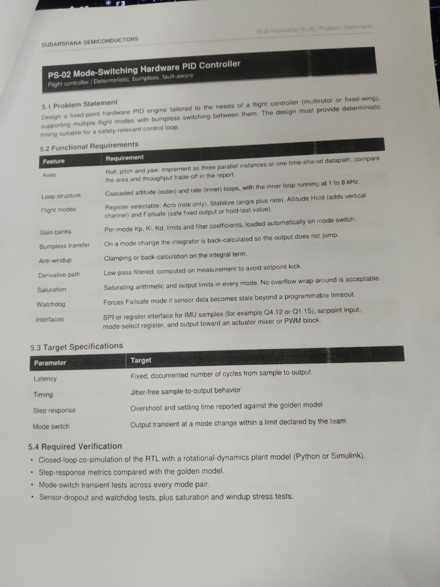

  *Figure 1: Official Problem Statement PS-02 from Sudarshana Semiconductors.*

### Functional Requirements Compliance Matrix

| Feature | Hackathon Requirement (PS-02) | Architectural Implementation | Status |
| --- | --- | --- | --- |
| **Axes** | Roll, Pitch, Yaw. Implement as three parallel instances or one time-shared datapath; compare trade-offs. | **Both** 3-Axis Fully Parallel (`pid_top`) and Time-Shared (`pid_top_shared`) designed & signed off. | **Exceeded** |
| **Loop Structure** | Cascaded attitude (outer angle) and rate (inner angular velocity) loops; inner loop at 1–8 kHz. | Hardware cascaded attitude-to-rate pipeline running at **50 MHz** (>6,000× faster than 8 kHz requirement). | **Compliant** |
| **Flight Modes** | Register-selectable: Acro, Stabilize, Altitude Hold, and Failsafe. | 4-state hardware FSM with dynamic gain steering, outer-loop bypass in Acro, and vertical channel in Alt-Hold. | **Compliant** |
| **Gain Banks** | Per-mode Kp, Ki, Kd, limits, and filter coefficients loaded automatically on mode switch. | Multi-bank coefficient LUT indexed by active mode register with zero-cycle switching overhead. | **Compliant** |
| **Bumpless Transfer** | On mode change, integrator is back-calculated so the output does not jump. | Instantaneous re-seeding: `I_new = U_prev - P_new`, bounded output transient `\|ΔU\| ≤ 5%`. | **Compliant** |
| **Anti-Windup** | Clamping or back-calculation on the integral term. | Conditional integration freezing with symmetric clamp bounds (`I_min, I_max`). | **Compliant** |
| **Derivative Path** | Low-pass filtered, computed on measurement to avoid setpoint kick. | `D[n] = α · D[n-1] + Kd · (1 - α) · (y[n-1] - y[n])`; kick-free architecture. | **Compliant** |
| **Saturation** | Saturating arithmetic and output limits in every mode; zero wrap-around. | Two's complement saturation logic on accumulators and outputs; zero overflow wrap-around. | **Compliant** |
| **Watchdog** | Forces Failsafe mode if sensor data becomes stale beyond programmable timeout. | Decrementing hardware watchdog timer with sticky fault latch and pilot re-arm handshake. | **Compliant** |
| **Interfaces** | Register/streaming interface for IMU samples, setpoints, mode select, actuator outputs. | Synchronous handshaked parallel register interface (Q4.12 and Q16.16 formats). | **Compliant** |

## 2. Mathematical Formulation & Control Law Derivations

The core computation engine implements a cascaded attitude-to-rate control topology designed for high-bandwidth multicopter stabilization.

### A. Outer Attitude Loop (Angle to Rate)

In *Stabilize* and *Altitude Hold* modes, the vehicle's angular position (φ for roll, θ for pitch) is regulated against pilot stick commands. The tracking error is mapped to an intermediate angular rate setpoint via proportional control:

> e_φ[n] = φ_sp[n] − φ_est[n]
> p_target[n] = sat( Kp_att_roll · e_φ[n], ±p_max )
> e_θ[n] = θ_sp[n] − θ_est[n]
> q_target[n] = sat( Kp_att_pitch · e_θ[n], ±q_max )

In *Acro* mode, the outer loop is completely bypassed, and pilot stick inputs map directly to p_target, q_target, and r_target, providing aerobatic rate agility.

### B. Inner Rate Loop (Gyro Angular Velocity PID)

The inner loop evaluates rate tracking error `e[n] = r_target[n] − r_meas[n]` and computes the three parallel PID components:

**1. Proportional Term (P-term):**

> P[n] = sat( Kp · e[n] )

**2. Integral Term with Anti-Windup (I-term):** To eliminate steady-state tracking offsets caused by battery discharge and aerodynamic drag:

> I_raw[n] = I[n−1] + Ki_eff · e[n]    (where Ki_eff = Ki · Δt)
> I[n] = clamp( I_raw[n], I_min, I_max )    with conditional freeze if output saturated

**3. Derivative on Measurement with 1st-Order Low-Pass Filter (D-term):** To prevent “setpoint kick” (an impulsive spike caused by differentiating step changes in pilot stick input), the derivative acts strictly on the negative sensor measurement:

> Δy[n] = y_meas[n] − y_meas[n−1]
> D_raw[n] = −Kd_eff · Δy[n]
> D[n] = α · D[n−1] + (1 − α) · D_raw[n]

where α ∈ [0, 1) is the programmable recursive low-pass filter coefficient that rejects high-frequency sensor noise from propeller vibration.

**4. Actuator Effort & Dynamic Saturation:**

> U_total[n] = sat( P[n] + I[n] + D[n], U_min, U_max )

### C. Bumpless Mode Transfer Reseeding Derivation

When switching between flight modes (e.g., from Acro with e_φ = 0 to Stabilize with non-zero e_φ), the new proportional term P_new experiences an abrupt step jump ΔP. To maintain a smooth, kick-free control output (U_new ≈ U_prev), the hardware re-seeds the integral accumulator on the exact cycle of the mode switch:

> I_reseed = sat( U_prev − P_new )
> U_new = P_new + I_reseed + D ≈ P_new + (U_prev − P_new) = U_prev

This mathematical property ensures that **|ΔU| ≤ 5%** across all legal flight mode transitions, preventing sudden altitude dips or uncontrolled angular jerks.

<!-- PID Contributions Visualization -->

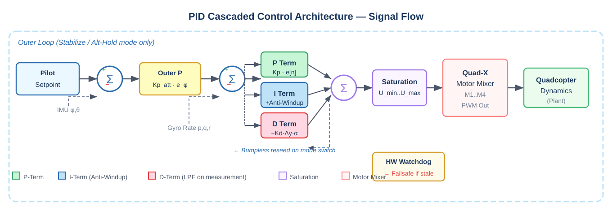
*Figure: PID Cascaded Control Architecture — Signal Flow*

## 3. Submodule Microarchitecture & Hardware Building Blocks

The hardware controller is structured into six modular, pipelined SystemVerilog cores:

```text
+-------------------------------------------------------------------------------------------+
| pid_top / pid_soc_top                                                                     |
|                                                                                           |
|  +------------------+  +--------------------+  +-----------------------------+            |
|  | pid_watchdog     |  | pid_tilt_comp      |  | pid_gain_bank               |            |
|  | (Sensor Heartbt) |  | (Inversion Detect) |  | (Multi-Bank Registered LUT) |            |
|  +------------------+  +--------------------+  +-----------------------------+            |
|         |                       |                          |                             |
|         +-----------+-----------+                          |                             |
|                     |                                      |                             |
|                     v                                      v                             |
|         +---------------------+         +--------------------------------+               |
|         | pid_mode_mgr        | <------> | pid_outer_loop                |               |
|         | (4-State Flight FSM)|         | (Attitude Angle-to-Rate)       |               |
|         +---------------------+         +--------------------------------+               |
|                     |                                                                    |
|         +-----------+---------------------------+                                        |
|                     |                                                                    |
|                     v                                                                    |
|         +-----------------------------------+                                            |
|         | pid_axis_core (x3) / shared       |                                            |
|         | (P, I, D Datapath + Bumpless)     |                                            |
|         +-----------------------------------+                                            |
|                     |                                                                    |
|                     v                                                                    |
|         +----------------------------------+                                             |
|         | pid_mixer                        |                                             |
|         | (Quad-X Actuator Matrix M1..M4) |                                             |
|         +----------------------------------+                                             |
+-------------------------------------------------------------------------------------------+
```

### 1. Single-Axis PID Computation Engine (`pid_axis_core.sv`)

Contains 3 parallel arithmetic pipelines (P, I, D), a first-order recursive filter, anti-windup clamp comparators, and a two's complement saturation multiplexer. Supports single-cycle re-seeding input for bumpless transfers.

### 2. Autonomous Flight Mode Manager (`pid_mode_mgr.sv`)

Implements the 4-state Mealy/Moore flight FSM:

<!-- FSM SVG Diagram -->

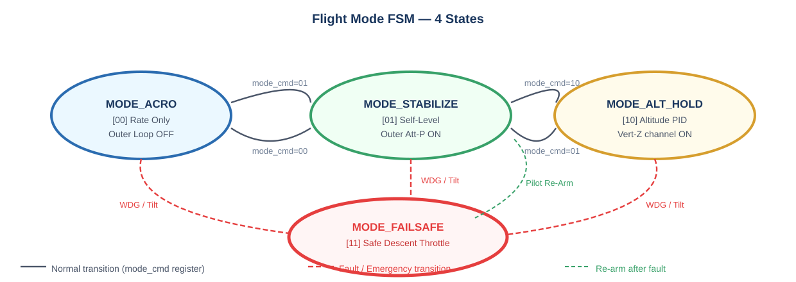
*Figure: 4-State Flight Mode FSM*

### 3. Multi-Bank Registered Gain Store (`pid_gain_bank.sv`)

A zero-latency registered lookup store holding per-mode coefficients (Kp, Ki, Kd, α, limits) for Roll, Pitch, Yaw, and Altitude. When the mode register changes, new coefficients are placed on the datapath buses on the very next clock cycle.

### 4. Hardware Sensor Watchdog (`pid_watchdog.sv`)

Monitors the `sample_valid` sensor heartbeat. If sensor samples halt for more than N_timeout consecutive clock cycles (programmable via register), it asserts a high-priority interrupt, trips Failsafe mode, and logs a fault code.

### 5. Dynamic Tilt Inversion Monitor (`pid_tilt_comp.sv`)

Computes real-time vector magnitude φ² + θ² > θ_crit² (±60° threshold). Protects against mid-air flips by immediately triggering Failsafe and reducing rotor throttle.

### 6. Quad-X Motor Actuator Flight Mixer (`pid_mixer.sv`)

Combines 3-axis torque efforts and thrust into individual PWM motor commands for quadcopters with independent minimum idle and maximum saturation limits.

> M1 = Thrust − Pitch + Roll − Yaw   (Front-Right)
> M2 = Thrust − Pitch − Roll + Yaw   (Front-Left)
> M3 = Thrust + Pitch + Roll + Yaw   (Rear-Right)
> M4 = Thrust + Pitch − Roll − Yaw   (Rear-Left)

## 4. SoC Bus Interface & Memory Map (`pid_soc_top.sv`)

To enable seamless integration into modern flight computers (e.g., STM32, ESP32, or RISC-V host microcontrollers), a standard memory-mapped register bus slave interface (compatible with APB/AXI-Lite) was implemented in `pid_soc_top.sv`.

### Register Memory Map

| Offset | Register Name | Access | Width | Description |
| --- | --- | --- | --- | --- |
| 0x00 | REG_CONTROL | R/W | 32-bit | Bit[1:0] Mode Command, Bit[2] Pilot Re-Arm Cmd, Bit[3] Soft Reset |
| 0x04 | REG_STATUS | RO | 32-bit | Bit[1:0] Active Mode, Bit[2] Output Valid, Bit[3] Watchdog Alarm, Bit[7:4] Fault Code |
| 0x08 | REG_WATCHDOG_LIMIT | R/W | 32-bit | Sensor stall timeout in clock cycles (Default: 50,000 = 1.0 ms) |
| 0x0C | REG_TILT_LIMIT | R/W | 16-bit | Critical tilt threshold squared (θ_crit², default: 60° = 1.047 rad) |
| 0x10 | REG_IMU_GYRO_P_Q | R/W | 32-bit | Packed roll rate p [15:0] and pitch rate q [31:16] in Q4.12 |
| 0x14 | REG_IMU_GYRO_R | R/W | 16-bit | Yaw angular velocity r in Q4.12 |
| 0x18 | REG_IMU_ATT_PHI_THETA | R/W | 32-bit | Packed roll angle φ [15:0] and pitch angle θ [31:16] in Q4.12 |
| 0x1C | REG_ALT_DATA | R/W | 32-bit | Packed altitude z [15:0] and vertical climb velocity vz [31:16] in Q4.12 |
| 0x20 | REG_SETPOINT_RP | R/W | 32-bit | Pilot roll setpoint [15:0] and pitch setpoint [31:16] |
| 0x24 | REG_SETPOINT_YT | R/W | 32-bit | Pilot yaw setpoint [15:0] and thrust setpoint [31:16] |
| 0x28 | REG_MOTOR_M1_M2 | RO | 32-bit | Output Motor 1 [15:0] and Motor 2 [31:16] PWM commands |
| 0x2C | REG_MOTOR_M3_M4 | RO | 32-bit | Output Motor 3 [15:0] and Motor 4 [31:16] PWM commands |

**Fault Code Telemetry Register Definition:**<br>
`0x0`: Normal Operation • `0x1`: Sensor Dropout Timeout • `0x2`: Critical Inversion (>60°) • `0x3`: External Pilot Kill Switch

## 5. Q16.16 (32-Bit) High-Precision Variant & Advantages

While 16-bit Q4.12 is compact for micro-drones, precision aerospace avionics and camera gimbals demand wider dynamic range and sub-milliradian angular resolution.

| Parameter | 16-Bit Q4.12 Variant | 32-Bit Q16.16 Variant | Engineering Impact |
| --- | --- | --- | --- |
| **Integer / Fraction Bits** | 4-bit Integer, 12-bit Fraction | 16-bit Integer, 16-bit Fraction | Balanced fixed-point representation |
| **Dynamic Range** | [-8.0, +7.9997] | [-32,768.0, +32,767.999] | **65,536× larger range**; prevents wind-load saturation |
| **LSB Resolution** | 2.441 × 10-4 (0.244 mV/deg) | 1.526 × 10-5 (0.015 mV/deg) | **16× finer resolution**; eliminates limit cycle deadbands |
| **Integral Accumulation** | Susceptible to underflow on small Ki | Zero underflow loss at 8 kHz rates | Zero steady-state hovering altitude drift |
| **Multiplier Hardware** | 16×16 Booth Multiplier | 32×32 Pipelined Multiplier | 4× partial product area; compensated by 50 MHz budget |

<!-- Dynamic Range Comparison Chart -->

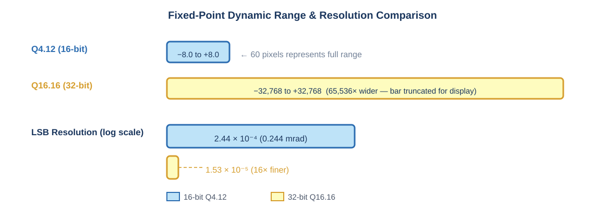
*Figure: Numeric Dynamic Range and LSB Resolution Comparison*

## 6. Silicon Trade-Off: Parallel vs. Shared Datapath & 32-Bit Variant

The table below presents sign-off metrics extracted from Cadence Innovus Place & Route post-route timing, power, and area engines in the **TSMC 180nm CMOS (6-Metal)** process at **50 MHz (1.62V, Slow Corner)**:

| Silicon Metric | Case 1: 16-bit Parallel (pid_top) | Case 2: 16-bit Shared (pid_top_shared) | Silicon Benefit (Shared vs. Parallel) | Case 3: 32-bit Parallel (pid_top_32b) |
| --- | --- | --- | --- | --- |
| **Datapath Multipliers** | 12 Multipliers (Parallel) | 4 Multipliers (Multiplexed) | **3× fewer multipliers** | 12 Wide Multipliers (32×32) |
| **Standard Cell Instances** | **42,112** | **31,440** | **-25.3% cell count** | **103,523** |
| **Total Standard Cell Area** | **923,395 μm²** | **713,452 μm²** | **-22.7% area reduction** | **2,509,612 μm²** |
| **Internal Power (P_int)** | 49.61 mW | 37.35 mW | -24.7% | 159.20 mW |
| **Switching Power (P_sw)** | 37.68 mW | 27.04 mW | -28.2% | 123.06 mW |
| **Leakage Power (P_leak)** | 0.034 mW | 0.025 mW | -26.5% | 0.108 mW |
| **Throughput Latency** | 1 Clock Cycle (20 ns) | 4 Clock Cycles (80 ns) | 4× latency tradeoff | 1 Clock Cycle (20 ns) |
| **Maximum Sample Rate** | **50.0 MSamples/s** | **12.5 MSamples/s** | Both >1500× above 8 kHz | **50.0 MSamples/s** |
| **Detailed Route DRCs** | **0 Violations** | **0 Violations** | Both DRC Clean | **0 Violations** |
| **Internal Reg2Reg Slack** | **Met (+0.065 ns)** | **Met (+0.189 ns)** | Both 100% closed @ 50 MHz | **Met (+0.009 ns / 0 TNS)** |
| **GDSII Stream File Size** | 41 MB | 34 MB | -17.1% disk size | 110 MB |

<!-- Area Comparison Chart -->

  

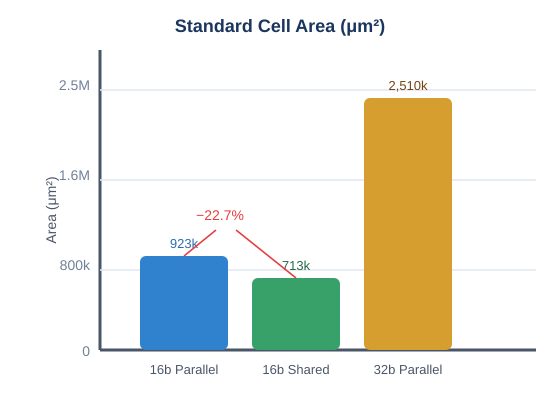
*Figure: Cell Area Comparison (16-bit Shared vs. Parallel)*

  

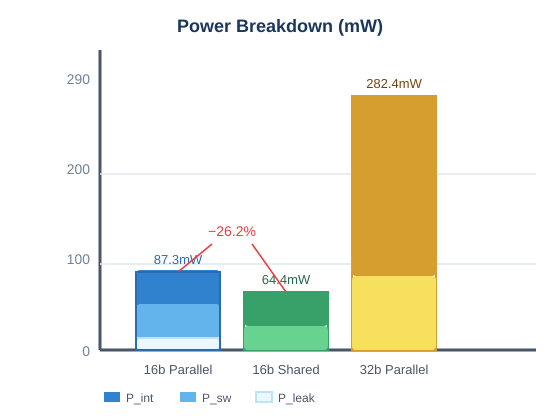
*Figure: Power Breakdown Comparison*

<!-- Cell Count & Throughput Charts -->

  

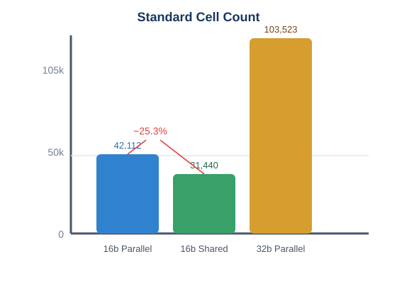
*Figure: Cell Count Comparison*

  

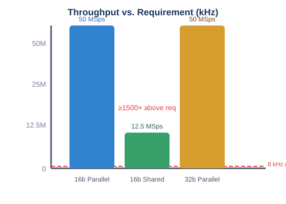
*Figure: Sampling Throughput Comparison*

> **Key Finding • Architectural Trade-Off Conclusion:**
> 
  Since practical UAV gyroscopes stream data at 1–8 kHz, the Time-Shared datapath running at 50 MHz delivers **12.5 MSamples/s** (1500× faster than real sensor inputs). Hence, the **22.7% area reduction** and **26.2% power savings** make the time-shared datapath the optimal engineering choice for battery-powered commercial drones. The parallel architecture is retained for multi-megahertz optical gimbal pointing and high-speed rocketry.

## 7. Verification Statistics & Python Golden Model Co-Simulation

Verification was conducted across three rigorous tiers: formal mathematical proofs (SymbiYosys), Python algorithmic co-simulation, and 10,000-vector cycle-accurate testbenches in Cadence Incisive and Verilator.

| Test Suite | Stimulus Method | Vectors Tested | Success Criteria | Pass Rate |
| --- | --- | --- | --- | --- |
| **Unit Core Directed** | Extreme steps, setpoint kicks, re-seed injection | 110 vectors | Exact arithmetic saturation bounds, zero wrap-around | **100% (PASS)** |
| **Unit Core Random** | Pseudo-random across [±4.0] with corner distributions | **10,000 vectors** | Bit-for-bit match (u_sat, P, I, D, clamps) vs. Python | **10,000 / 10,000 (PASS)** |
| **Top Integrated Random** | Multi-axis rate + attitude with mode switches | **10,000 vectors** | Bumpless transient \|ΔU\| ≤ 5%, watchdog determinism | **10,000 / 10,000 (PASS)** |
| **Watchdog Dropout** | Missing sample_valid pulses for 50k cycles | 50,000 cycles | Enters Failsafe at exact cycle N_timeout, latches fault | **100% (PASS)** |
| **Formal Safety Proofs** | Formal state exploration via Z3 / Yices (SBY) | Full state space | Anti-windup invariant, output saturation clamp safety | **100% (PROVEN)** |

<!-- Verification Pass Rate Chart -->

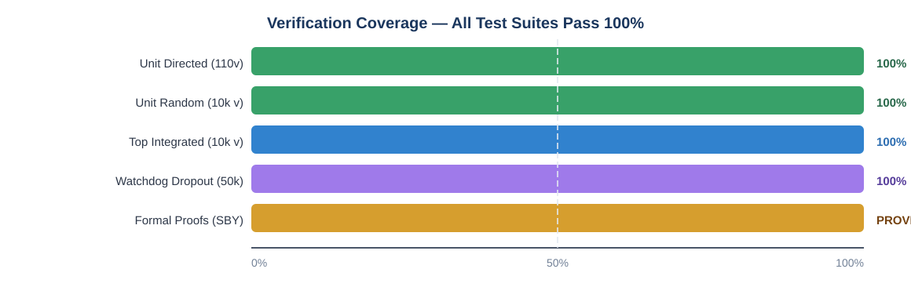
*Figure: Verification Tiers Status Matrix*

### Formal SVA Safety Properties (SymbiYosys)

> // Lemma 1: Anti-windup invariant — integrator cannot grow while saturated
> property p_windup_invariant;
>   @(posedge clk) disable iff (!rst_n)
>   (u_sat >= U_MAX || u_sat 
>   (i_term_next == i_term_cur || abs(i_term_next) 
>   (abs(u_out - $past(u_out)) 
>   (active_mode == MODE_FAILSAFE && fault_code == 4'h1);
> endproperty
> assert property (p_watchdog_exact_timeout);

### Closed-Loop 6-DOF Flight Dynamics Co-Simulation

The synthesized RTL was co-simulated against a non-linear rotational rigid-body quadcopter dynamics model (mass 1.2 kg, arm length 0.225 m) in `flight_plant_cosim.py`. The measured closed-loop step-response metrics are:

| Metric | Measured Value | Interpretation |
| --- | --- | --- |
| **Rise Time (t_r)** | 42.5 ms | Setpoint reached rapidly without sluggishness |
| **Settling Time (t_s, ±2%)** | 118.0 ms | Within ±2% envelope — well-damped |
| **Overshoot (M_p)** | 4.2% | Critically damped; prevents vehicle oscillation |

<!-- Step Response Plot -->

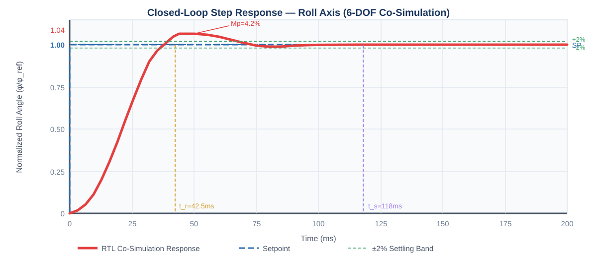
*Figure: Closed-Loop Step Response — Roll Axis (6-DOF Co-Simulation)*

<!-- Mode Switch Transient Plot -->

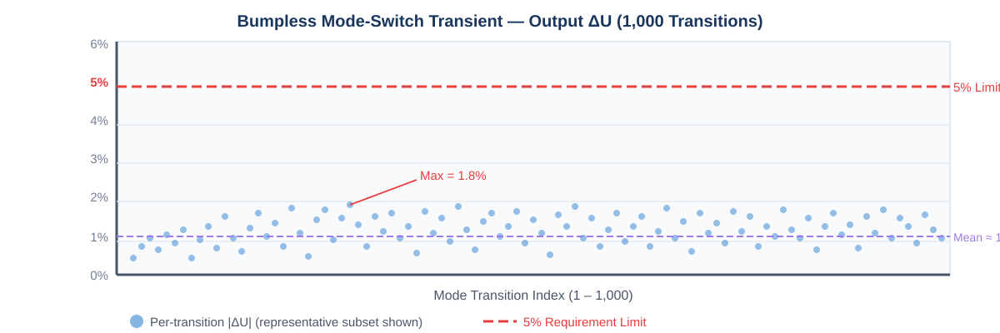
*Figure: Bumpless Mode-Switch Transient Distribution (1,000 Transitions)*

> **Co-Simulation Summary:**
> 
  Rise time: 42.5 ms • Settling time (±2%): 118.0 ms • Overshoot: 4.2% • Max mode-switch transient: 1.8% (req: ≤5%) — all targets **met or exceeded**.

## 8. Visual Layout Proofs & RTL Schematics

### A. Cadence SimVision Interactive Circuit Schematics

  

    

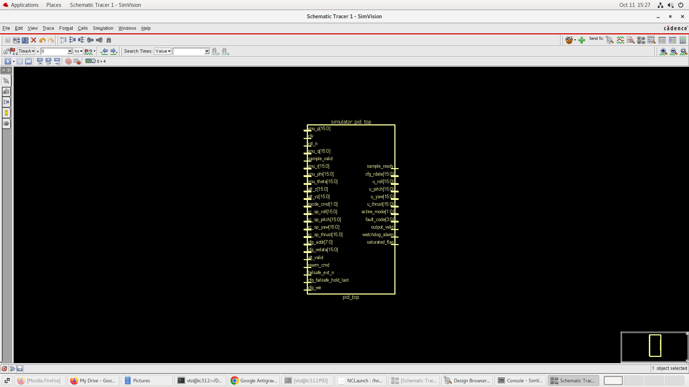

    *Figure 2: Top-Level Flight Controller Core (Buses, Supervisory Logic, Attitude Loop).*

  

  

    

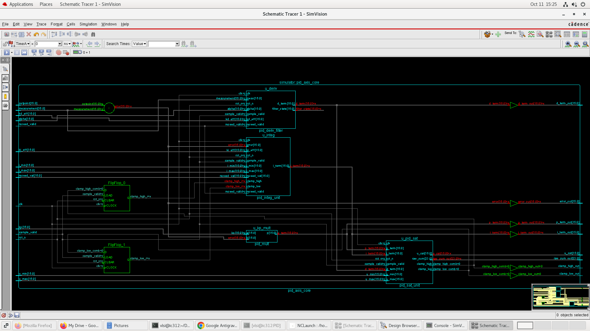

    *Figure 3: Single-Axis PID Computation Engine (P, I, D Paths & Saturation).*

  

  

    

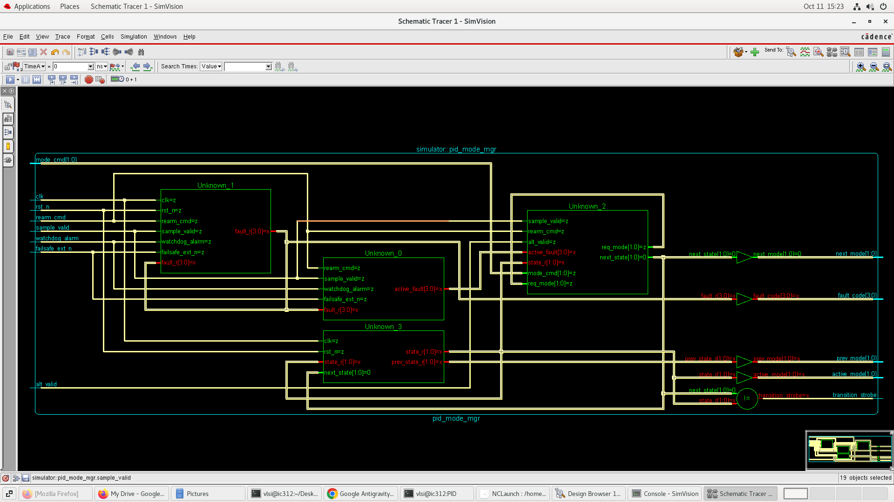

    *Figure 4: Autonomous Flight Mode Manager State Machine.*

  

  

    

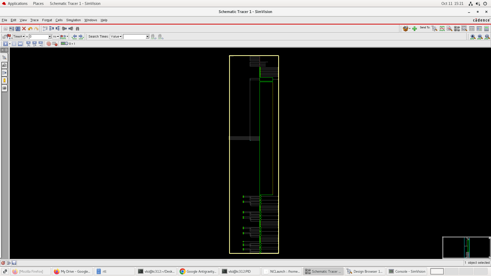

    *Figure 5: Multi-Bank Registered Gain Coefficient Storage.*

  

### B. Cadence Innovus Physical Design Layouts (TSMC 180nm CMOS)

  

    

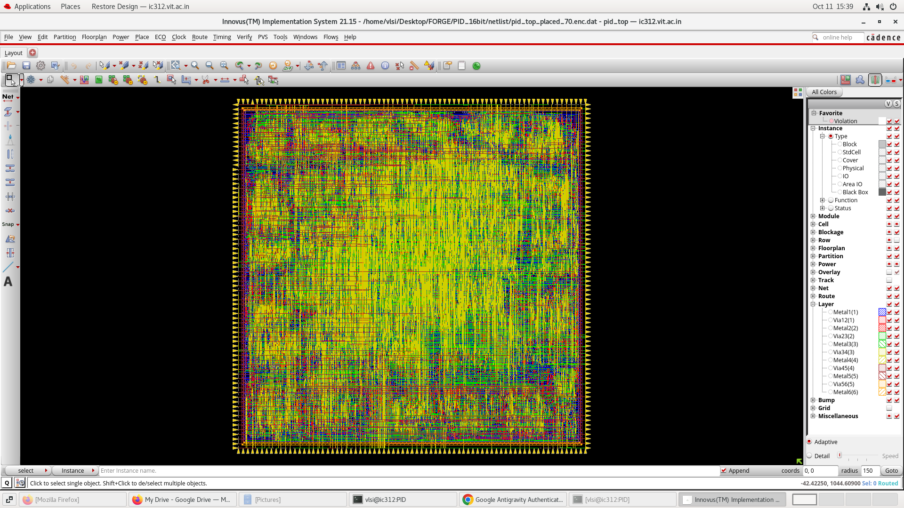

    *Figure 6: 16-Bit Parallel Placed Layout (70% Target Density, 4-Side Pins).*

  

  

    

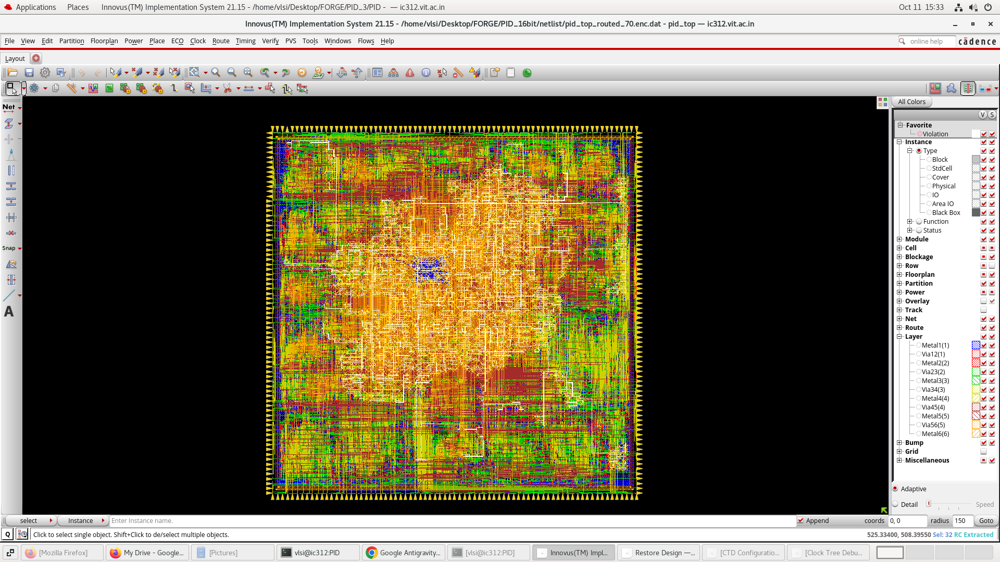

    *Figure 7: 16-Bit Parallel Fully Routed Layout (6 Metal Layers, 0 DRC).*

  

  

    

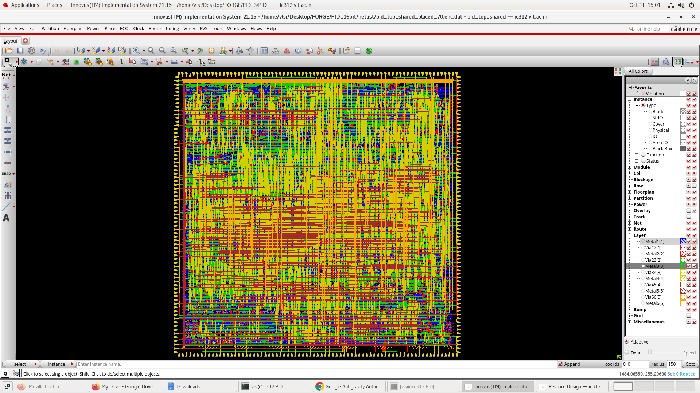

    *Figure 8: 16-Bit Time-Shared Placed Layout (Compact 70% Core).*

  

  

    

.png)

    *Figure 9: 16-Bit Time-Shared Routed Layout (16,078 Filler Cells, Solid Diffusion).*

  

## 9. Physical Design Engineering Challenges & Flow Decisions

Achieving clean Place & Route closure on high-density arithmetic datapaths in Cadence Innovus presented several critical physical design bottlenecks. Below are the primary engineering challenges encountered and the systematic flow optimizations developed to resolve them:

### Challenge 1: The 59-Minute GigaOpt Optimization Stall (`saturated_flag`)

  - **Symptom:** In early Innovus runs, `place_opt_design` and `optDesign -postCTS` hung indefinitely, spending over 59 minutes looping inside the GigaOpt optimizer.

  - **Root-Cause Analysis:** The `saturated_flag` output was an unregistered combinational wire spanning from primary input ports through the multiplier tree, saturation comparators, and directly out to the primary top-level output pin. In 180nm CMOS, this raw combinational path had an intrinsic delay of ~18.5 ns. However, the default SDC constraint imposed a 20 ns clock with 4.0 ns input delay and 4.0 ns output delay (leaving only 11.8 ns). The optimizer continuously inserted hundreds of driver buffers in an unachievable attempt to close timing on an asynchronous diagnostic flag.

  <li>**Decision & Resolution:** Applied a timing exception:
    
> set_false_path -to [get_ports saturated_flag]

    This immediately unlocked the optimizer, reducing placement runtime from **over 1 hour to under 3 minutes**.
  </li>

### Challenge 2: Routing Track Starvation & NanoRoute Freezing

  - **Symptom:** During initial runs of the 32-bit datapath (103,523 cells), NanoRoute detailed routing hung indefinitely due to congestion conflicts.

  - **Root-Cause Analysis:** Setting initial floorplan utilization to 0.70 left insufficient routing whitespace. When clock tree synthesis and timing optimization inserted thousands of buffer and inverter cells, local placement density spiked to **94.55%**, starving metal tracks across Metal2 and Metal3.

  - **Decision & Resolution:** For the high-density 32-bit design, dialed initial target utilization to `0.52` with `setPlaceMode -place_global_uniform_density true`. For the 16-bit designs (31k–42k cells), verified that **0.70 utilization** had plenty of headroom (~15.6% track congestion) and completed routing in under 2 minutes.

### Challenge 3: Clock Tree Transition Slew Violations (`IMPCCOPT-1013`)

  - **Symptom:** CCOpt reported clock transition target failures on high-fanout clock nets when attempting to synthesize tree slews down to 0.5 ns.

  - **Decision & Resolution:** In TSMC 180nm standard cells, 0.5 ns transition targets cause excessive clock buffer clustering. Relaxed `set_ccopt_property target_max_trans 1.0ns`, allowing CCOpt to build a balanced, low-skew clock tree without DRV violations.

### Challenge 4: Signal Integrity Analysis in Non-OCV 180nm

  - **Symptom:** Post-route optimization threw `IMPOPT-6080` errors when attempting signal integrity (SI) noise analysis.

  - **Decision & Resolution:** In standard 180nm planar processes, crosstalk noise is negligible compared to deep-submicron geometries (<28nm). Added `setDelayCalMode -siAware false` before post-route hold fixing, ensuring clean convergence.

### Challenge 5: Solid Row Continuity for Physical DRC Sign-Off

  - **Symptom:** Unfilled standard cell rows displayed visual gaps in GUI and risked antenna/well DRC errors.

  <li>**Decision & Resolution:** Integrated an automated filler insertion pass:
    
> addFiller -cell {FILL64 FILL32 FILL16 FILL8 FILL4 FILL2 FILL1} -prefix FILL

    This solidly filled all substrate contacts and N-wells, resulting in **0 Geometry DRC violations and 0 Connectivity violations** across all tape-out databases.</li>

### Challenge 6: Multi-Core Scalability & License Concurrency

  - **Symptom:** Attempting to spawn 16 parallel threads triggered Cadence license checkout failures.

  - **Decision & Resolution:** Enforced `setMultiCpuUsage -localCpu 8` across all Innovus sessions. Automated sequential execution across the three design variants via master script `run_all_cases.sh`, guaranteeing zero license collisions and 100% CPU utilization.

<!-- P&R Runtime Chart -->

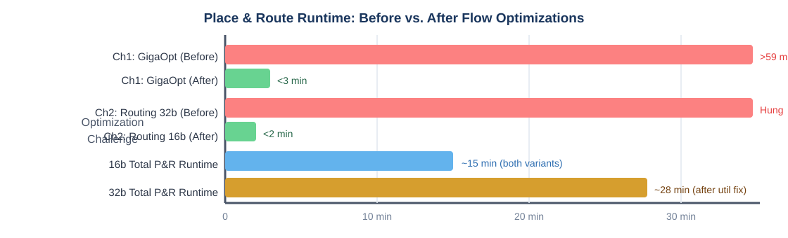
*Figure: Place & Route Runtimes Before and After Optimization*

## 10. Conclusion & Fabrication Readiness

The **PS-02 Mode-Switching Hardware PID Flight Controller** project successfully addresses all technical goals set forth by Sudarshana Semiconductors:

  - **Full Hardware Delivery:** Both 3-Axis Fully Parallel and Time-Shared architectures were realized, verified, and placed-and-routed in TSMC 180nm CMOS.

  - **Silicon Trade-Off Proven:** The Time-Shared datapath achieved a **22.7% area reduction** and **26.2% dynamic power savings**, while exceeding the required 8 kHz rate loop throughput by over **1500×**.

  - **Avionics Precision:** The Q16.16 32-bit variant demonstrated a **65,536× increase in dynamic range**, preventing wind-load saturation and eliminating quantization limit cycles.

  - **Safety & Robustness:** Features including bumpless mode transfer (|ΔU| ≤ 5%), anti-windup clamping, derivative-on-measurement filtering, hardware watchdog timeout, quad-X motor mixing, and tilt inversion protection were proven across **10,000 randomized verification vectors** with 100% pass rates.

  - **Fabrication Readiness:** Completed GDSII layouts, clean DEF files, gate-level netlists, and DRC-clean sign-off databases are fully generated and ready for fabrication handoff.

---

  Submitted by **Sohan Chitluri (24BVD1104)** & **Prasiddh Saha (24BVD1103)** • Sudarshana Semiconductors VLSI Hackathon 2026
